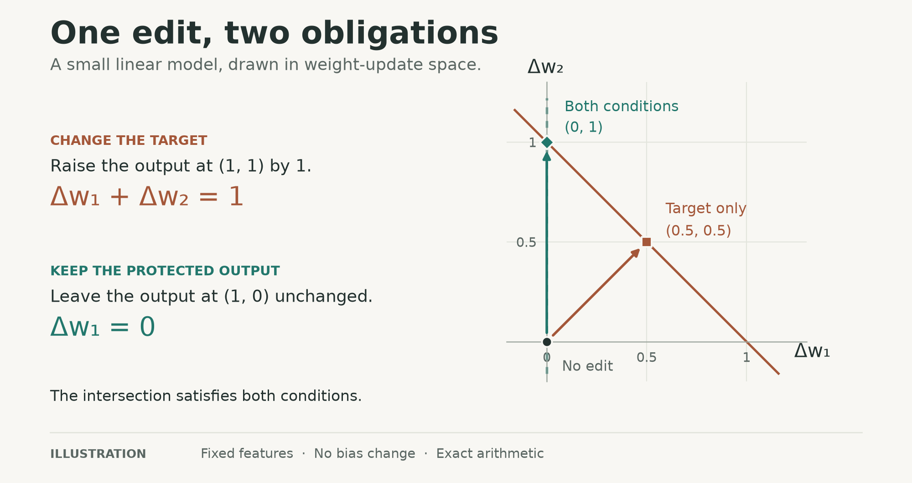
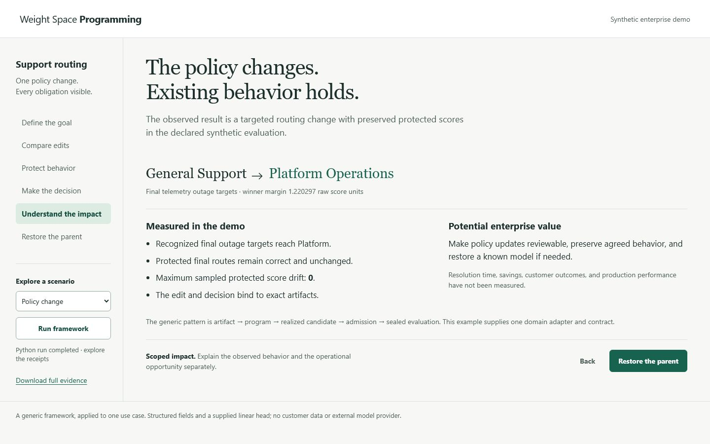

# Weight Space Programming Framework

**Read, diagnose, edit, and create neural-network weights.**

A weight edit can improve one output and disturb another. This research framework
makes that relationship inspectable: it records the model, the proposed edit, the
candidate actually produced, and the evidence used to evaluate it.

The framework is generic. Common interfaces describe artifacts, proposals, access
conditions, and evaluation records. Explicit adapters define execution semantics
and the conditions for behavioral guarantees. RTS is one historical application.

[Worked example](#one-edit-two-obligations) · [Enterprise use case](#an-enterprise-policy-change) · [Quick start](#try-the-example) ·
[Evidence](#what-the-evidence-shows) · [Documentation](#explore-the-framework)

## One edit, two obligations

Start with a linear output head whose weights are `(1, 1)`. Raise its output at
feature `(1, 1)` from **2 to 3**, while keeping its output at `(1, 0)` equal to **1**.



| Choice | New weights | Target output | Protected output |
| --- | --- | ---: | ---: |
| Keep the parent | `(1, 1)` | 2 | 1 |
| Target-only edit | `(1.5, 1.5)` | 3 | 1.5 |
| Edit with protection | `(1, 2)` | 3 | 1 |

The target-only edit has the smallest Euclidean update norm among edits that meet
the target exactly. It changes a coefficient used by both inputs. The protected
edit changes only the second coefficient, leaving the protected output unchanged.
If the target itself must be preserved, the requested change becomes impossible.

This example uses **fixed features, no bias change, and exact arithmetic**. The
[worked explanation](docs/weight-space/v2/worked-example.md) derives the updates
and follows them through the API. It also explains why numerical fitting and
native precision need further checks.

[Explore the interactive model](artifacts/explanations/edit-retention/index.html)
locally to vary the edit and protected set. The still is also available as an
[editable SVG](artifacts/explanations/readme-edit/edit-geometry.svg), with its
[source assumptions](artifacts/explanations/readme-edit/source.json).

## Try the example

Use Python 3.11 or newer from this repository root:

```bash
python -m venv .venv
# Activate .venv using the command for your shell.
python -m pip install -e .
python examples/edit_retention.py
weight-space --help
```

The example reports target outputs, protected residuals, and a request blocked by
full protection. The compiler uses positive ridge regularization, so its fitted
edit can retain target error even when protection is exact.

The core requires NumPy and no external model provider. The Python import remains
`rlcd.weight_space`. For optional PyTorch support, environment details, evidence
replay, and proof builds, see [Reproducing the work](REPRODUCING.md).

The standalone installation uses `pyproject.toml` through the command above.
The retained `requirements*.txt` files describe the original RLCD environment.

## An enterprise policy change

Route telemetry outage tickets to Platform Operations while preserving billing,
security, and ordinary support behavior. The
[enterprise walkthrough](docs/use-cases/enterprise-support-routing.md) uses the
generic compiler, structural policy, retention certificates, cooperative session,
sealed evaluation, and exact rollback:

```bash
python examples/enterprise_support_routing.py
```

The runnable example compares the unchanged parent, target-only fitting, soft
retention, and nullspace protection. It records a successful routing change,
abstention when protection makes the request impossible, and rejection when an
unseen symptom exposes a feature-coverage gap.

[Inspect the business reports](artifacts/enterprise/support-routing/README.md)
and image flowchart. The records and baseline are synthetic; this example
establishes an integration pattern, not enterprise deployment performance.

[Watch the browser walkthrough](artifacts/enterprise/support-routing/demo/walkthrough.mp4)
or [run the guided interface](demos/enterprise-routing/README.md). It follows the
task contract, candidate tradeoff, protected coefficient, sealed evaluation,
measured impact, and actual parent restoration. The 90-second recording also shows
abstention and a final-gate rejection, with explanations on screen and a quiet
cinematic music bed. [Music credit](artifacts/enterprise/support-routing/demo/MUSIC.md).

[](artifacts/enterprise/support-routing/demo/walkthrough.mp4)

## What the evidence shows

The synthetic study found a **target–retention tradeoff**. Soft retention reduced
collateral error, while leaving more error on the requested target:

| Method | Mean target NRMSE ↓ | Mean collateral NRMSE ↓ |
| --- | ---: | ---: |
| Target-only ridge | 0.038695 | 0.888351 |
| Soft retention | 0.360218 | 0.199321 |

**Lower is better for both metrics.** Both are dimensionless root-mean-square
errors divided by the RMS of the requested shift `(0.6, -0.3, 0)`, `sqrt(0.15)`.
They are not accuracy or success percentages.

The study compared paired checkpoints from independently generated synthetic
worlds, using ReLU, tanh, and convolution-plus-tanh features. Only the output heads
were trained and edited. There was no live LLM/provider arm, so this study does
not measure an LLM's ability to discover edits.

The [results](docs/weight-space/v2/results.md) retain world-cluster uncertainty,
family differences, baselines, precision effects, no-op outcomes, and repeated-edit
failures. The [methods](docs/weight-space/v2/methods.md) explain the comparison.

### What the proofs establish

Under the stated real-valued assumptions, an edit that vanishes on protected
feature directions also vanishes on their span. Supported sequential networks
also admit explicit output-drift bounds.

Using those results for a deployed model requires the right feature equation,
domain, endpoint, and numerical execution argument. The [proof guide](PROOFS.md)
makes these premises explicit.

## What remains open

The current implementation uses inspectable, dense artifacts and explicit
semantic families. Callers must run structural and behavioral checks; submitting
a candidate does not certify it.

The [research plan](docs/weight-space/v2/limitations-and-next-steps.md) connects
the remaining limits to concrete success and failure criteria:

- General behavioral admission and automatic binding of new candidates to proofs.
- Verified floating-point execution and an isolated live-provider harness.
- Evidence of useful large-model editing and stronger cumulative edit contracts.

All published study seeds have been observed. Replaying them is reproduction;
fresh confirmation needs untouched units and a newly frozen protocol.

## Explore the framework

| To understand… | Read |
| --- | --- |
| The motivation and original research | [Framework guide](docs/weight-space/v2/README.md) · [Source review](docs/weight-space/v2/source-review.md) |
| How to represent and check an edit | [Architecture and API](docs/weight-space/v2/architecture.md) · [Task workflow](docs/weight-space/v2/workflow.md) |
| The guarantees and their premises | [Formal explanation](docs/weight-space/v2/formal.md) · [Proof reproduction](PROOFS.md) |
| The study and its outcomes | [Methods](docs/weight-space/v2/methods.md) · [Results](docs/weight-space/v2/results.md) |
| The gaps and next research decisions | [Limitations and next steps](docs/weight-space/v2/limitations-and-next-steps.md) · [Requirements](docs/weight-space/v2/requirements.md) |
| The supporting records | [Evidence map](EVIDENCE.md) · [Verification scope](VERIFICATION.md) |

The image flowcharts cover the [task lifecycle](docs/images/task-lifecycle.png),
[architecture](docs/images/architecture.png), and
[evidence branches](docs/images/evidence-branches.png).

## Project record

**Public research draft · `v0.2.0-draft.4`.** The draft release remains unpublished.
Project-authored code, documentation, and diagrams use the [MIT license](LICENSE).
Retained third-party material keeps its own licenses and notices; see [RIGHTS.md](RIGHTS.md).

The [changelog](CHANGELOG.md) records subsequent changes; the
[draft notes](releases/v0.2.0-draft.4.md) describe the prepared snapshot.

The documentation uses [STE-Pro-Max](https://github.com/shyamsridhar123/STE-Pro-Max):
concrete examples, explicit mechanisms, and evidence with its conditions. The
[revision record](provenance/documentation-revision.json) identifies the guidance
used for the documentation rewrite.

<details>
<summary>Publication provenance, verification, and rights</summary>

[PUBLICATION.md](PUBLICATION.md) records the source identities, disclosed
redactions and omissions, and verification limits of the public snapshot.
Original code, frozen evidence, and earlier documents retain their identities in
the [source inventory](provenance/source-files.json). The
[sanitation ledger](provenance/public-sanitization.json) identifies public
derivatives and omitted files without rewriting the original hashes.

Run `python scripts/verify_publication.py` to check publication integrity. That
check does not establish exact replay of a historical freeze whose inputs were
sanitized. [VERIFICATION.md](VERIFICATION.md) explains what was checked; no new
hosted-CI success is claimed here.

See [CONTRIBUTING.md](CONTRIBUTING.md) for changes and [RIGHTS.md](RIGHTS.md) for
attribution and rights.

</details>
