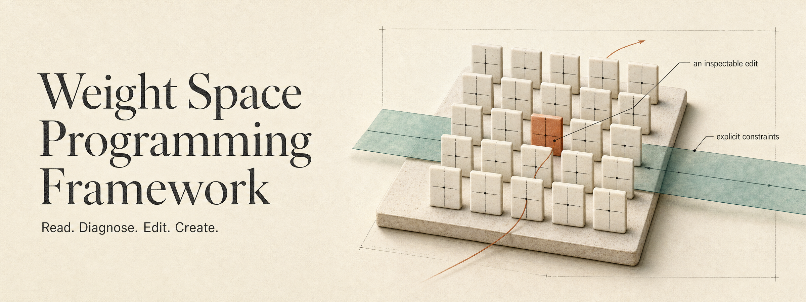
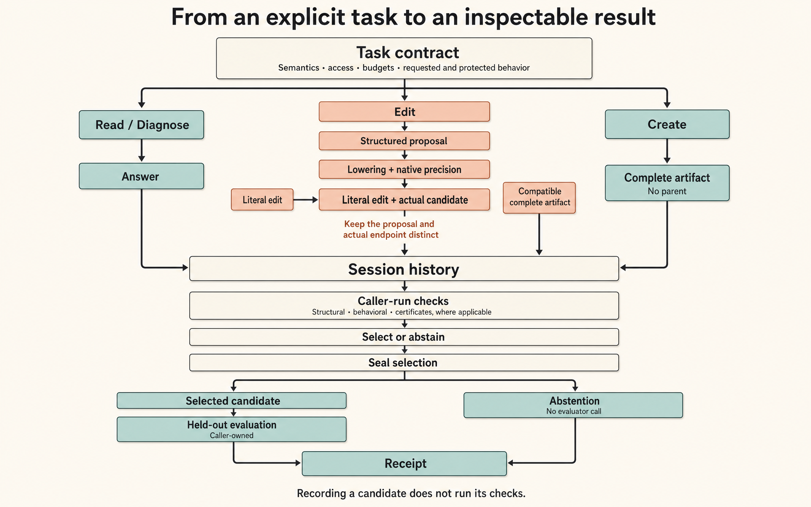
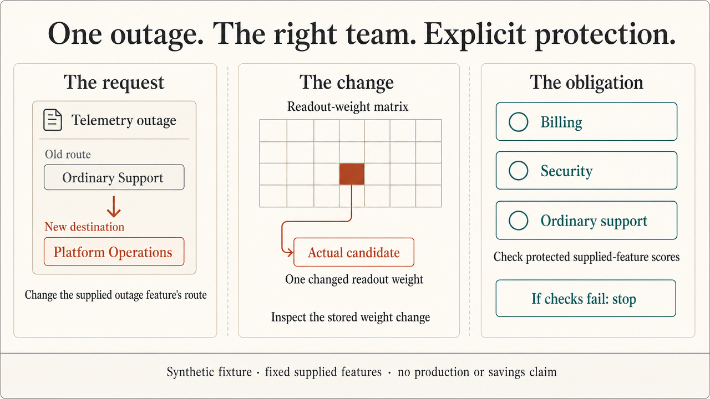
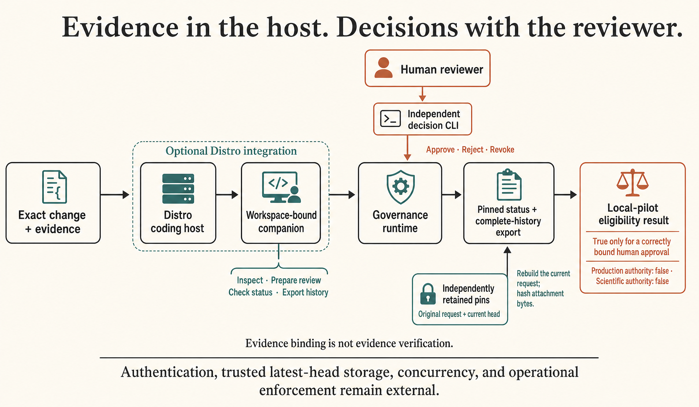

# Weight Space Programming Framework



**Read, diagnose, edit, and create neural-network weights—with explicit obligations and inspectable evidence.**

A weight edit can improve one output and disturb another. This research framework
makes the whole change inspectable: the task, the parent model, the proposed edit,
the candidate actually produced, and the evidence used to accept it or stop.

**Public research draft** · [MIT](LICENSE) · Python 3.11+

[Use case](#start-with-one-support-ticket) · [Quick start](#run-it) ·
[Architecture](#how-the-framework-fits-together) · [Distro](#review-the-change-in-distro) ·
[Proofs and evidence](#start-with-the-property-to-preserve) · [Documentation](#go-deeper)

## Start with one support ticket

A telemetry outage reaches the wrong support queue. The requested change is
simple: **route the outage to Platform Operations while preserving billing,
security, and ordinary-support behavior.**

The framework makes both sides of that request explicit. It proposes a routing
head edit, checks the realized candidate against the declared constraints, and
records the result. A request can end in a useful change, an abstention, or a
failure that explains why the change should stop.

[](artifacts/enterprise/support-routing/demo/walkthrough.mp4)

[Watch the 90-second walkthrough](artifacts/enterprise/support-routing/demo/walkthrough.mp4)
· [Run the interactive story](demos/enterprise-routing/README.md)
· [Read the transcript](artifacts/explanations/enterprise-story/story.md)

| Situation | What the example demonstrates |
| --- | --- |
| A routing change is feasible | The selected candidate changes the intended route and checks protected scores. |
| Protection rules out the change | The workflow abstains. |
| An unseen symptom is not represented | A feature-coverage failure blocks the candidate. |

The [enterprise example](docs/use-cases/enterprise-support-routing.md) uses
synthetic structured tickets, a supplied feature extractor, and a constructed
linear head. Preserving supplied-feature scores does not establish behavior on
arbitrary tickets. Avoiding an extra team transfer is the operational opportunity;
customer savings and production performance have not been measured.

## Run it

From a checkout, with Python 3.11 or newer:

```bash
python -m pip install -e .
python examples/enterprise_support_routing.py
```

For the smaller mathematical example and the command-line interface:

```bash
python examples/edit_retention.py
weight-space --help
```

The core uses NumPy and needs no external model provider. The Python import is
`rlcd.weight_space`. [Reproducing the work](REPRODUCING.md) covers isolated
environments, optional PyTorch support, evidence replay, and proof builds. The
standalone package uses `pyproject.toml`; retained `requirements*.txt` files
describe the original RLCD environment.

## How the framework fits together

Support routing is one application. The same task and artifact interfaces support
four kinds of work:

| Task | Submission |
| --- | --- |
| **Read** | An answer about a weight artifact. |
| **Diagnose** | An answer about model behavior under the declared task. |
| **Edit** | A literal edit, a lowered structured proposal, or a compatible complete artifact. |
| **Create** | A complete artifact, without a parent model. |



**Declare the task.** Name the artifact semantics, access conditions, budgets,
requested behavior, and protected behavior. Explicit adapters define how a
supported model executes and which guarantees apply. Storing arbitrary tensors
does not supply an evaluator or certificate for every architecture.

**Inspect the actual candidate.** A literal edit binds an exact parent. A
structured edit passes through lowering and native precision; projection can
change the requested update. Preserve the proposal and the realized endpoint as
separate records.

**Run the checks, then select or abstain.** `ProgrammerSession` records candidates,
access, budgets, selection, and evaluation. The caller must run applicable
structural, behavioral, and certificate checks. Recording a candidate does not
run those checks automatically. Selection is sealed before caller-owned held-out
evaluation produces its receipt. A sealed abstention also receives a receipt,
without an evaluator call.

[Architecture and API](docs/weight-space/v2/architecture.md) ·
[Task lifecycle](docs/weight-space/v2/workflow.md)

## One edit, two obligations

The smallest example makes the central idea visible. Start with weights `(1, 1)`.
Raise the output at feature `(1, 1)` from **2 to 3**, while keeping the output at
feature `(1, 0)` equal to **1**.


| Choice | New weights | Target output | Protected output |
| --- | --- | ---: | ---: |
| Keep the parent | `(1, 1)` | 2 | 1 |
| Target-only edit | `(1.5, 1.5)` | 3 | 1.5 |
| Edit with protection | `(1, 2)` | 3 | 1 |

The target-only edit changes a coefficient used by both inputs. The protected edit
changes only the second coefficient. If the target itself is protected, the
requested change is impossible.

This illustration assumes **fixed features, fixed bias, and exact arithmetic**.
The numerical compiler uses positive ridge regularization, so a fitted edit can
retain target error. Native precision and the actual endpoint need their own
checks. [Follow the derivation and API](docs/weight-space/v2/worked-example.md)
or [explore the interactive model locally](artifacts/explanations/edit-retention/index.html).

## Review the change in Distro

The optional Distro companion brings the change and its evidence into a coding
host. It connects the host to the existing governance runtime through a
workspace-bound plugin.

```bash
python -m pip install ".[distro]"
python -m rlcd.weight_space distro demo --workspace ../wsp-distro-demo
cd ../wsp-distro-demo
distro claude --plugin-dir .runs/distro-plugin
```

Use a **new demo directory**. The generator creates a separate, smaller synthetic
routing fixture and checks its supplied-feature retention certificate. It changes
one readout weight so the supplied outage feature moves from Ordinary Support to
Platform Operations. Keep the generated plugin configuration local.



The empty circles mark check obligations. If the fixture's checks fail, generation
stops with an error; this path does not create a session-abstention receipt.

Ask the host:

> Inspect `change.json`. Explain which route changes, which supplied scores stay
> the same, and what the evidence does not prove. Prepare a review and return
> both pins for me to retain independently. Leave the decision to the human reviewer.

| Operation | Companion tool |
| --- | --- |
| Inspect the exact change and evidence | `wsp_inspect_change` |
| Prepare a review request | `wsp_prepare_review` |
| Check the current review status | `wsp_review_status` |
| Export the complete review history | `wsp_export_review` |



Approval, rejection, and revocation remain separate human actions. Status and
export reconstruct the complete current request, hash the actual evidence bytes,
and check the independently retained original-request and current-head pins.
Those pins must come from a record outside the received bundle.

A correctly bound human approval can confer **local-pilot eligibility only**.
Evidence binding does not automatically verify the evidence's claims.
Production and scientific authority remain false. Authentication, trusted
latest-head storage, concurrent decision serialization, and operational
deployment or revocation remain external responsibilities.

The [usage guide](docs/governance/distro-usage.md) covers the Copilot launch path,
human decisions, and native-host validation. Installed-wheel MCP operations and
native plugin management were checked; live Distro-launched model tool invocation
remains untested. The core framework works independently of Distro.

## Start with the property to preserve

Begin with the obligation, its assumptions, and the evidence needed to check the
actual candidate. The [proof guide](PROOFS.md) connects supported mathematical
claims to their premises:

- **Fixed-feature heads:** an edit that vanishes on protected feature directions
  also vanishes on their represented span, under the stated real-valued assumptions.
- **Supported sequential networks:** explicit real-valued output-drift bounds
  apply under the corresponding layer and domain assumptions.
- **Local governance:** a checked abstract Lean state machine describes review
  transitions and eligibility. It does not prove refinement of the Python runtime.

These results do not establish feature-extractor correspondence, general
floating-point execution correctness, or deployment readiness. Structural
admission alone leaves `behavioral_status: not_checked` and
`formal_certificate: null`. Each additional claim needs its own evidence.

### What the research currently supports

| Evidence | Finding and boundary |
| --- | --- |
| [Synthetic head-editing study](docs/weight-space/v2/results.md) | Soft retention reduced collateral error while leaving more target error. It establishes a target–retention tradeoff in that study. |
| [Trained applications](docs/research/trained-applications.md) | Ownership-routing changes had utility; recognition repair did not. Hard protected candidates abstained. |
| [Retention development comparison](docs/research/retention-development.md) | Useful ownership edits appeared only under the loosest score budget. The comparison supplies no untouched confirmation or deployment evidence. |
| [Live studies](docs/research/live-studies.md) | Useful live weight editing was not established; diagnosis coverage missed its frozen threshold. |
| [Original-source repeat](docs/research/original-source-repeat.md) and [construction/steering pilot](docs/research/construction-steering-pilot.md) | Delivery failures left no completed live candidate to assess. |
| [Synthetic unlearning](docs/research/synthetic-unlearning.md) | Edited arms failed the study's acceptance gates. Finite accessibility measurements establish no erasure or privacy guarantee. |

The [evidence map](EVIDENCE.md) retains the results, abstentions, failures, and
verification limits. Published study seeds have already been observed. Fresh
confirmation requires untouched units and a newly frozen protocol.

The next research decisions concern useful large-model editing, cumulative
changes, behavioral admission, execution guarantees, and trustworthy provenance.
The [limitations](docs/weight-space/v2/limitations-and-next-steps.md) and
[November research roadmap](docs/weight-space/v2/research-roadmap-2026-11.md)
connect these gaps to concrete success and failure criteria and
[tracked work](docs/weight-space/v2/research-issues-2026-11.md).

## Go deeper

| You want to… | Start here |
| --- | --- |
| Understand the original motivation | [Framework guide](docs/weight-space/v2/README.md) · [Source review](docs/weight-space/v2/source-review.md) |
| Build an adapter or task | [Architecture and API](docs/weight-space/v2/architecture.md) · [Task workflow](docs/weight-space/v2/workflow.md) |
| Reproduce the enterprise example | [Use case](docs/use-cases/enterprise-support-routing.md) · [Business reports](artifacts/enterprise/support-routing/README.md) |
| Examine the proof obligations | [Proof guide](PROOFS.md) · [Formal explanation](docs/weight-space/v2/formal.md) · [Feasibility guard](docs/research/feature-feasibility.md) |
| Integrate governance | [Distro usage](docs/governance/distro-usage.md) · [Integration contract](docs/governance/distro-integration.md) · [Checked model](formal/governance/README.md) · [Enterprise handoff](docs/governance/distro-handoff.md) |
| Assess or reproduce the evidence | [Evidence map](EVIDENCE.md) · [Methods](docs/weight-space/v2/methods.md) · [Reproduction](REPRODUCING.md) · [Verification scope](VERIFICATION.md) |

## Project record

**`v0.2.0-draft.4` is an unpublished research draft.** Project-authored code,
documentation, and diagrams use the [MIT license](LICENSE). Retained third-party
material keeps its own licenses and notices; see [RIGHTS.md](RIGHTS.md).
The [changelog](CHANGELOG.md) and [draft notes](releases/v0.2.0-draft.4.md)
record the project's development.

The documentation applies [STE-Pro-Max](https://github.com/shyamsridhar123/STE-Pro-Max)
guidance: concrete examples, explicit mechanisms, and evidence with its conditions.
The [revision record](provenance/documentation-revision.json) identifies the
historical guidance and verification scope. Existing diagrams retain their
[renderer provenance](docs/images/flowchart-manifest.json). The four new README
illustrations were generated with OpenAI `gpt-image-2` through Creative Studio;
their [artwork brief](docs/images/readme/README.md) and
[generation record](provenance/readme-artwork-20261110.json) preserve the prompts,
selected assets, and review limits.

<details>
<summary>Publication provenance, reproduction, and media credits</summary>

[PUBLICATION.md](PUBLICATION.md) records source identities, disclosed redactions
and omissions, and verification limits. The [source inventory](provenance/source-files.json)
and [sanitation ledger](provenance/public-sanitization.json) preserve the
distinction between retained sources and public derivatives.

Run `python scripts/verify_publication.py` to check publication integrity.
[VERIFICATION.md](VERIFICATION.md) explains the scope of that check and historical
verification. Publication checks do not establish replay of sanitized historical
inputs or new scientific results.

The walkthrough is an existing browser recording with visible English subtitles
and quiet music. [Subtitle file](artifacts/enterprise/support-routing/demo/subtitles.srt)
· [Music credit](artifacts/enterprise/support-routing/demo/MUSIC.md)
· [Geometry illustration and assumptions](artifacts/explanations/readme-edit/source.json).

See [CONTRIBUTING.md](CONTRIBUTING.md) for changes and [RIGHTS.md](RIGHTS.md) for
attribution and rights.

</details>
