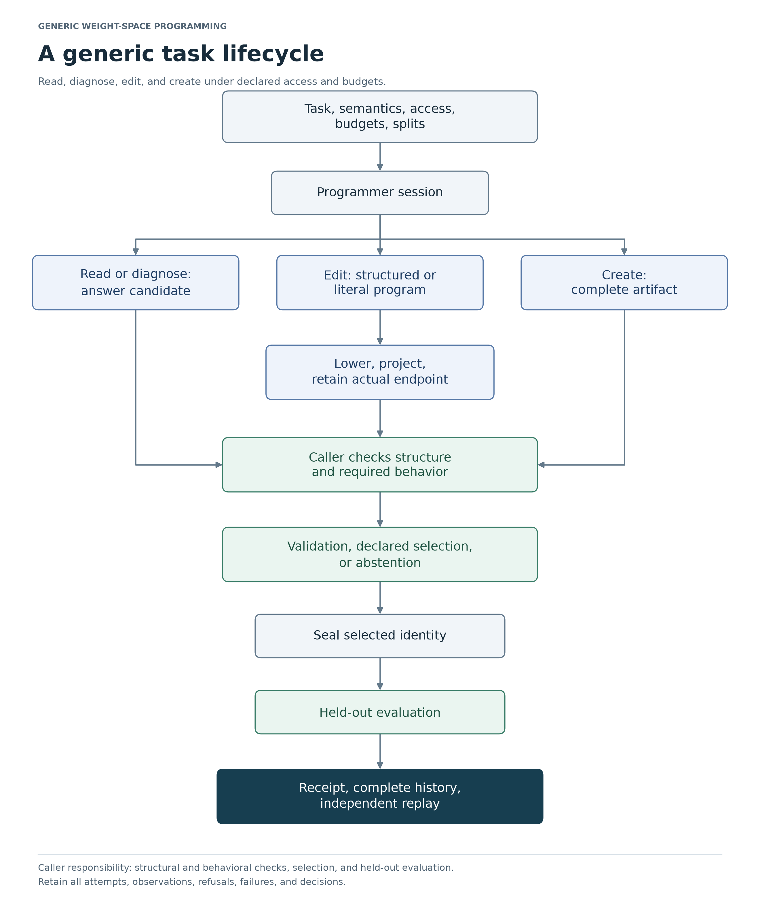

# Weight Space Programming Framework

**Research draft · `v0.2.0-draft.4` · publication candidate**

This candidate prepares a sanitized public snapshot of the private draft.3.
[PUBLICATION.md](PUBLICATION.md) explains the original source identities,
disclosed redactions and omissions, and verification limits. The draft release
remains unpublished; this page does not assert a completed public transition
or a successful hosted run for draft.4.

A weight edit can improve one output and disturb another. This framework makes
that relationship inspectable: it records the exact model and edit, checks
supported preservation conditions, and keeps evaluation evidence tied to the
candidate that was actually produced.

The framework supports **reading, diagnosing, editing, and creating neural-network
weights**. The common interfaces describe artifacts, proposals, access conditions,
and evaluation records. Execution semantics and behavioral guarantees come from
explicit adapters. RTS is one historical application; the framework does not
require a game.

## Start with an edit you can understand

Consider a linear output head with weights `(1, 1)`. Raise its output at feature
`(1, 1)` from 2 to 3 while preserving its output at `(1, 0)`.

| Choice | New weights | Target output | Protected output |
| --- | --- | ---: | ---: |
| Keep the parent | `(1, 1)` | 2 | 1 |
| Minimum Euclidean-norm exact target-only update | `(1.5, 1.5)` | 3 | 1.5 |
| Edit that protects the second condition | `(1, 2)` | 3 | 1 |

The target-only update changes a coefficient used by both inputs. The protected
edit uses a direction that leaves the protected output unchanged. If the target
itself must be preserved, the request becomes impossible under this model.

This is an illustrative exact-arithmetic case. The [worked example](docs/weight-space/v2/worked-example.md)
derives it, runs it through the API, and explains how numerical fitting and
native precision change the obligations. An [interactive version](artifacts/explanations/edit-retention/index.html)
lets you vary the edit and protected set; download or open it locally to use it.

## What the current evidence supports

The synthetic study found a **target–retention tradeoff**. Compared with
target-only ridge editing, soft retention reduced mean collateral NRMSE from
`0.888351` to `0.199321`, while mean target NRMSE rose from `0.038695` to
`0.360218`. Lower is better for both metrics. Both are dimensionless
root-mean-square errors, divided by the RMS of the requested shift
`(0.6, -0.3, 0)`, `sqrt(0.15)`; neither is an accuracy or success percentage.

The comparison used paired checkpoints from independently generated synthetic
worlds, with ReLU, tanh, and convolution-plus-tanh features. Only the output heads
were trained and edited. The [results](docs/weight-space/v2/results.md) give the
world-cluster uncertainty, family differences, baselines, precision effects,
no-op outcomes, and repeated-edit failures. There was no live LLM/provider arm.
The study tests these editing mechanisms; it does not measure an LLM's ability
to discover them.

The proofs establish conditional real-valued results: an edit that vanishes on
protected feature directions also vanishes on their span, and supported sequential
networks admit explicit output-drift bounds. Applying those results to a deployed
model still requires the right feature equation, domain, endpoint, and numerical
execution argument. The [proof guide](PROOFS.md) makes these premises explicit.

## Install and run the example

Use Python 3.11 or newer from this repository root:

```bash
python -m venv .venv
# Activate .venv using the command for your shell.
python -m pip install -e .
python examples/edit_retention.py
weight-space --help
```

The example reports target outputs, protected residuals, and a request blocked
by full protection. It also shows why the compiler's positive ridge can leave
target error even when protection is exact. The core requires NumPy and no
external model provider. The Python import remains `rlcd.weight_space` to preserve
the implementation and its recorded evidence.

For optional PyTorch support, environment details, evidence replay, and proof
builds, use [REPRODUCING.md](REPRODUCING.md). The retained `requirements*.txt`
files belong to the original RLCD environment; the standalone installation uses
`pyproject.toml` through the command above.

## Read according to the question you need to answer

| Reader question | Start here |
| --- | --- |
| What does weight-space programming mean, and why is this framework needed? | [Framework guide](docs/weight-space/v2/README.md) |
| What did the original paper actually establish, and what did it leave open? | [Source review](docs/weight-space/v2/source-review.md) |
| How do I represent, realize, and check an edit? | [Architecture and API guide](docs/weight-space/v2/architecture.md) |
| How should access, candidate selection, failures, and held-out evaluation work? | [Task workflow](docs/weight-space/v2/workflow.md) |
| Which assumptions make the guarantees valid? | [Formal explanation](docs/weight-space/v2/formal.md) and [proof reproduction](PROOFS.md) |
| How was the study designed, and what happened? | [Methods](docs/weight-space/v2/methods.md) and [results](docs/weight-space/v2/results.md) |
| What blocks a stronger claim, and what should be done next? | [Limitations and research plan](docs/weight-space/v2/limitations-and-next-steps.md) |
| Where can I inspect the evidence and implementation obligations? | [Evidence map](EVIDENCE.md) and [requirements](docs/weight-space/v2/requirements.md) |



The caller runs structural and behavioral checks. Submission alone does not
certify a candidate. The flowchart is available as an [SVG image](docs/images/task-lifecycle.svg),
alongside the [architecture](docs/images/architecture.png) and
[evidence](docs/images/evidence-branches.png) flowcharts.

## Draft boundaries and project record

The current implementation uses inspectable, dense artifacts and explicit
semantic families. It does not yet provide generic behavioral admission,
automatic formal binding of new candidates, verified floating execution, an
isolated live-provider harness, or evidence of useful large-model editing.
All published study seeds have been observed. Replaying them is reproduction;
fresh confirmation needs untouched units and a newly frozen protocol.

The documentation follows [STE-Pro-Max](https://github.com/shyamsridhar123/STE-Pro-Max)
at the [recorded revision](provenance/documentation-revision.json): concrete
examples, explicit mechanisms, evidence with its conditions, and next steps
with success and failure criteria. The [changelog](CHANGELOG.md) and
[draft notes](releases/v0.2.0-draft.4.md) describe this revision.

Original code, frozen evidence, and earlier documents retain their recorded
identities in the [source inventory](provenance/source-files.json). The
[sanitation ledger](provenance/public-sanitization.json) identifies public
derivatives and omitted files; their original hashes are not rewritten to
match the public copies. Run `python scripts/verify_publication.py` to check
publication integrity. This does not establish exact replay of a historical
freeze whose inputs were sanitized. See
[VERIFICATION.md](VERIFICATION.md) for what was checked and what those checks
cannot establish, [CONTRIBUTING.md](CONTRIBUTING.md) for changes, and
[RIGHTS.md](RIGHTS.md) for attribution and rights. No project-wide license grant
has been selected for this draft.
