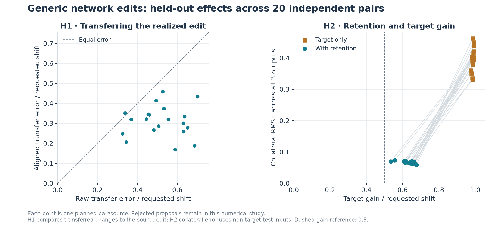
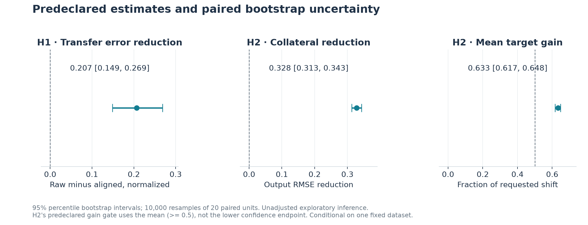
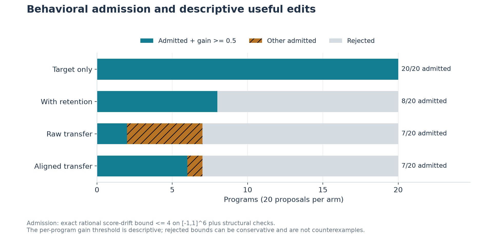
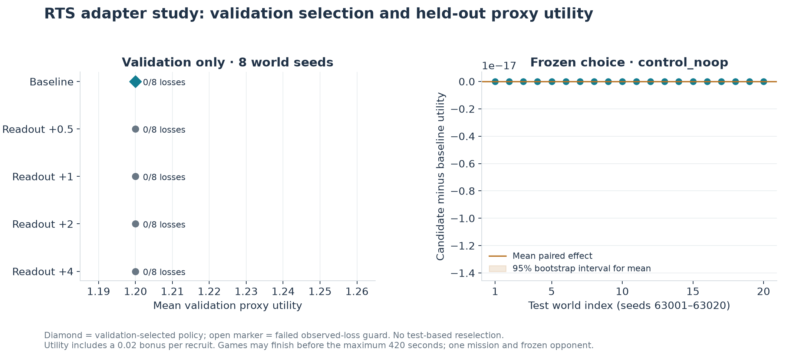

# Weight-space programming: frozen study results

The framework's generic tensor programs, explicit adapters, and proved ReLU semantics
support a reproducible separation between proposing an edit, admitting its contract,
and measuring its effects. This study completed all **40 independently initialized
regression networks, 20 disjoint network pairs, and 20 held-out RTS worlds**.
No failed planned unit was excluded. The independent evidence audit passed.

| Hypothesis and predeclared endpoint | Mean effect [95% paired bootstrap interval] | Outcome under the fixed rule |
| --- | --- | --- |
| H1: raw-minus-aligned transfer error, normalized by requested shift | 0.2066 [0.1487, 0.2688] | supported |
| H2: target-only minus retention-aware collateral RMSE | 0.3281 [0.3130, 0.3432] | supported |
| H2 target-gain gate: retention-aware mean target gain / requested shift | 0.6335 [0.6168, 0.6478] | Mean must be at least 0.5 |
| H3: frozen RTS choice minus baseline proxy utility | 0.0000 [0.0000, 0.0000] | unsupported |

These are **three exploratory hypotheses with unadjusted intervals**. Each interval
uses 10,000 percentile bootstrap resamples with seed 736021, resampling whole paired
units. H1/H2 inference is conditional on one fixed shared dataset. H3 concerns one
mission and authored opponent. A supported rule is local evidence, not a universal
property of weight-space programming. No provider calls were made.

## The general network study

Forty 6→16→3 ReLU regression networks were trained independently for 350 full-batch
Adam epochs on a fixed nonlinear analytic teacher. All optimization used CPU float64,
one Torch thread, and the frozen learning rate 0.015. Disjoint adjacent seeds
71001–71040 form 20 source/target pairs; a network appears in only one pair.
The shared Uniform[-1,1]^6 partition contains 2,048 training, 256 compilation,
512 validation, and 2,048 test examples. The test target region contains
672 examples; its complement contains 1376.
Mean base-network test MSE was 0.00590
(range 0.00464–0.00787).

The explicit specification requested an output-0 increase of 0.75 where x0 > 0.35,
with retention outside that region. A frozen-hidden readout least-squares compiler
used ridge 0.01, with retention weight either zero or eight. The same settings were
used for every network. Validation/test examples were never optimization inputs;
there was no synthetic model or hyperparameter selection.



**H1: alignment.** Raw and incoming-weight-aligned transfers were applied to the
independently trained target network. Their errors compare the transferred output-0
change with the source retention-aware edit's realized change, not with perfect
fulfillment of the requested 0.75. Mean normalized error was 0.5174
for raw transfer and 0.3108 for aligned transfer.
Alignment reduced error in 19/20 pairs.
Its correspondence is heuristic: independently trained hidden representations
need not be related by a function-preserving symmetry. Every transfer is a new
proposal and requires its own admission.

**H2: retention.** Mean collateral RMSE over all three output coordinates fell
from 0.3944 to 0.0663.
Mean target gain changed from 0.9878 to
0.6335 of the request. The fixed rule tests a positive collateral
reduction interval and a mean gain of at least 0.5; it does not require the gain
interval's lower endpoint to exceed 0.5. Retention is a soft penalty and does not
establish zero change on all unobserved inputs.



**Controls.** Known permutation/positive power-of-two gauges preserved the realized
edit to maximum normalized floating RMSE 3.9e-16.
Inferred recovery of those known gauges had maximum error
3.9e-16. The raw-coordinate permuted
negative control had mean error 0.7004.
Exact rational evaluations agreed at five saved test points per pair; those finite
checks complement the general Lean symmetry theorem and are not themselves a
universal proof. All positive controls passed.

## Admission is a separate outcome

Every proposal was checked against a score-drift budget of four per output over the
entire box [-1,1]^6, with readout-only writes and the structural restrictions in the
saved contract. H1/H2 retain all planned proposals, including rejected proposals,
in isolated numerical evaluation. A rejection can reflect a loose sufficient bound;
it is not evidence that the actual drift exceeds four.

For the following **descriptive** table, a useful edit means its held-out mean
output-0 target gain is at least half the request. This per-program threshold is
an analysis aid, not a new preregistered endpoint or an overall task-success metric.
Transfer usefulness here is measured on its target network.

| Arm | Proposed | Admitted | Gain ≥ 0.5 | Both | Both / all proposals | Both / admitted |
| --- | ---: | ---: | ---: | ---: | ---: | ---: |
| Target only | 20 | 20 | 20 | 20 | 100% | 100% |
| With retention | 20 | 8 | 20 | 8 | 40% | 100% |
| Raw transfer | 20 | 7 | 7 | 2 | 10% | 29% |
| Aligned transfer | 20 | 7 | 17 | 6 | 30% | 86% |



The complete per-program values, exact certificate references, and descriptive
flags are retained in [synthetic-arms.csv](synthetic-arms.csv) and
[analysis.json](analysis.json). These denominators prevent successful numerical
edits from being silently presented as deployed, certified edits.

## RTS as one downstream adapter

This adapter imports the actual authored, untrained 32→38→1 scorer with 1,293
parameters. The recruitment candidates edit only W2[0,19], attached to the hidden
feature ReLU(x24). The four requested increments were 0.5, 1, 2, and 4.
All four passed the global [0,1]^32 score bound and a zero-drift contract on x24=0.
The real-valued increments use the exact difference of serialized binary64 endpoints:

| Candidate | Requested increment | Actual rational increment |
| --- | ---: | --- |
| recruit_0_5 | 0.5 | `1/2` |
| recruit_1_0 | 1 | `1` |
| recruit_2_0 | 2 | `9007199254740991/4503599627370496` |
| recruit_4_0 | 4 | `18014398509481983/4503599627370496` |

The import check evaluated 1200 scored examples in
256 development/validation fixtures. Sequential Python
accumulation matched JavaScript scores exactly, with no choice mismatch. NumPy's
maximum score discrepancy was 8.88e-16, with
0 separately recorded argmax mismatches.
This tests the specific adapter's numerical agreement; it is not an IEEE proof.

| Split | World seeds | Evaluated arms including controls | Completed / planned paired records | Control records | Failed records |
| --- | ---: | ---: | ---: | ---: | ---: |
| development | 8 | 6 | 48/48 | 16 | 0 |
| validation | 8 | 6 | 48/48 | 16 | 0 |
| test | 20 | 2 | 40/40 | 40 | 0 |

Repeated baseline branches across candidate arms share the same world seed;
they do not increase the independent sample size. Recorded no-op and
shared-output-bias comparisons reported no first changed choice, matching terminal
state hashes, and equal utility in every split.
The bias control tests this scorer's argmax policy; the separate living-world
stochastic softmax policy has different semantics.

Validation chose **control_noop** using the highest mean utility
among candidates with no more observed losses than baseline; ties prefer the
smallest increment, and baseline was eligible. The selected bundle was written
before test execution. Test evaluated only that choice and the two controls.

The fixed selection rule retained the unchanged baseline. The test effect of zero is therefore a baseline consistency result; it is not an independent trial of a nonzero recruitment edit. H3 is unsupported. Because the selected policy is also the no-op control, test contains two distinct arms, with no duplicate no-op runs.

| Validation arm | Requested increment | Mean utility | Losses | Eligible |
| --- | ---: | ---: | ---: | --- |
| control_noop | 0 | 1.2000 | 0/8 | yes |
| recruit_0_5 | 0.5 | 1.2000 | 0/8 | yes |
| recruit_1_0 | 1 | 1.2000 | 0/8 | yes |
| recruit_2_0 | 2 | 1.2000 | 0/8 | yes |
| recruit_4_0 | 4 | 1.2000 | 0/8 | yes |



On 20 held-out world seeds, selected utility changed by 0.0000 [0.0000, 0.0000].
The selected policy had 0 losses and 20 wins;
baseline had 0 losses and 20 wins.
The observed-loss guard is not a statistical noninferiority test.

Utility is net opponent Town Center damage fraction minus net own Town Center
damage fraction, plus 0.02 per completed recruited soldier. The decomposition is:

| Branch | Mean utility | Net town-damage component | Recruitment bonus | Mean recruits | Finished before 270 s | Elapsed range |
| --- | ---: | ---: | ---: | ---: | ---: | --- |
| Baseline | 1.2000 | 1.0000 | 0.2000 | 10.00 | 20/20 | 174.1–174.1 s |
| Candidate | 1.2000 | 1.0000 | 0.2000 | 10.00 | 20/20 | 174.1–174.1 s |

Mean paired town-damage contribution changed by 0.0000;
the recruitment contribution changed by 0.0000.
Games stop naturally when terminal; 420 seconds is a maximum, not a guaranteed
observation window. Rival recruitment begins at 270 seconds and raid eligibility
at 330 seconds, so early terminal games do not test those later behaviors.
This declared proxy and mission cannot establish general RTS strategic improvement.

The independent auditor reconstructed utility from the retained raw HP, recruitment,
and outcome fields and checked the 1,800-point Town Center maximum against frozen
initialization sources and available export snapshots. Raw trial records retain
checkpoint hashes but omit the initial checkpoint bodies and most final checkpoint
bodies. Those omitted states and their hashes cannot be independently regenerated
from the retained raw records alone. This is a provenance limit, distinct from the
checked arithmetic, program identities, and recorded control comparisons.
Successful order histories are retained, but complete decision histories including
waits and rejected commands are not. The auditor checks and links first-change
records; it does not independently replay those missing decisions or recover raw
production metrics from absent checkpoint bodies.

## Formal guarantees and remaining limits

The [Lean project](../../../formal/weight-space/README.md) proves
hidden permutation and positive-rescaling invariance, transported edits, the exact
readout effect, a box bound for edits to every layer, finite drift composition, and
strict argmax preservation under sufficient margins. Its actual-policy specialization
embeds every exported coefficient and checks the four recruitment changes, their
global score bounds, and exact preservation on the protected region.

These are theorems about real-valued networks with exact rational lifts of stored
weights. The Python checker, exporter, PyTorch execution, JavaScript execution,
hardware rounding, and task reward are outside the proved boundary. Caller-supplied
architectures can use generic tensor programs and execution adapters; arbitrary
architectures do not inherit the ReLU compiler or proof backend. JSON copying,
dense alignment, and rational arithmetic are reference-scale implementations.
No universal natural-language-to-weights compiler, LLM editing benchmark, or new
Astra proposal-quality result is claimed.

## Reproduce and inspect

The protocol and executable study sources were frozen at `2026-11-07T01:11:34.823738+00:00`.
This is a local pre-result snapshot, not an external preregistration or a trusted
timestamp service. The source/protocol verifier still matches the archived bytes.
Reporting and independent audit scripts are separate analysis artifacts; their
hashes are retained with their results and they do not train, select, or simulate.

The workspace differs from the frozen execution tree in `rlcd/weight_space/__main__.py`. Exact old/new hashes are recorded in `analysis.json`. These later changes are not attributed to the completed study; its archived source bytes remain authoritative.

- Protocol SHA-256: `ae17fc858130ee06d436eb77218712b9a757ed514183b6bc99cb962ce7231998`
- Freeze receipt identity: `8618af22249c963a70f07966e39dd7db82f53064485707797485dc12d916ac6e`
- [Frozen protocol and sources](../study-v1/freeze/receipt.json)
- [Synthetic raw results](../study-v1/synthetic/results.json) and [manifest](../study-v1/synthetic/receipt.json)
- [Validation selection](../study-v1/rts-selection/selection.json) and [held-out RTS results](../study-v1/rts-test/results.json)
- [Independent audit](../study-v1-audit.json)
- [Report data and calculation checks](analysis.json), [artifact receipt](receipt.json), and [stage logs](../study-v1/logs)

From the repository root, choose unused output paths:

```powershell
pwsh -NoLogo -NoProfile -File scripts/run_weight_space_study.ps1 -Out artifacts/weight-space/my-study
.venv/Scripts/python.exe scripts/audit_weight_space_study.py --study artifacts/weight-space/my-study --out artifacts/weight-space/my-study-audit.json
.venv/Scripts/python.exe scripts/report_weight_space.py --study artifacts/weight-space/my-study --audit artifacts/weight-space/my-study-audit.json --out artifacts/weight-space/my-report
pwsh -NoLogo -NoProfile -File scripts/check_weight_space_proofs.ps1 -SkipCache
```

The [formal instructions](../../../formal/weight-space/README.md)
include regenerating the actual-policy instance from the selected study's exported
model before a new proof check. Each run retains all planned arms, control outcomes,
raw models/programs, admissions, failures, exact command arguments, and exit logs.
The plots are available as PNG and SVG; CSV files retain every displayed unit.
