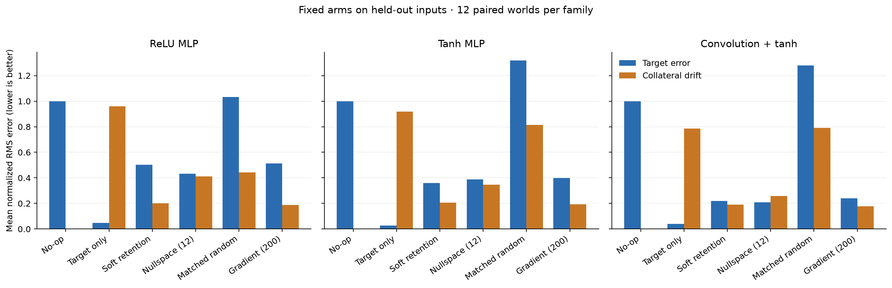
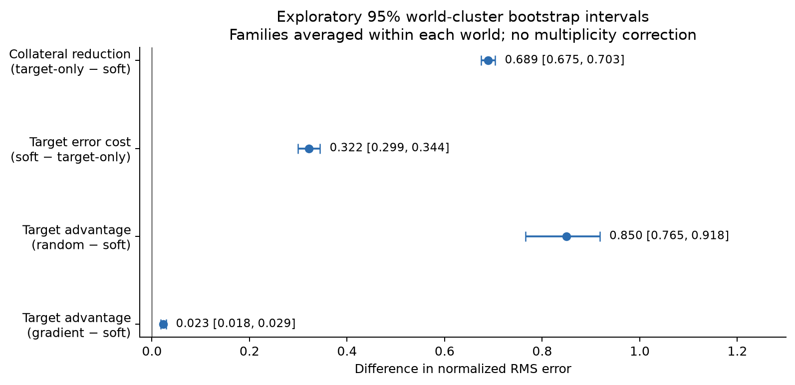
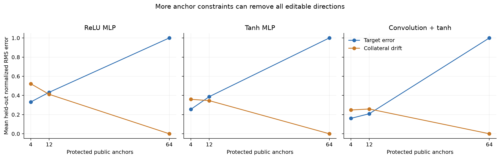
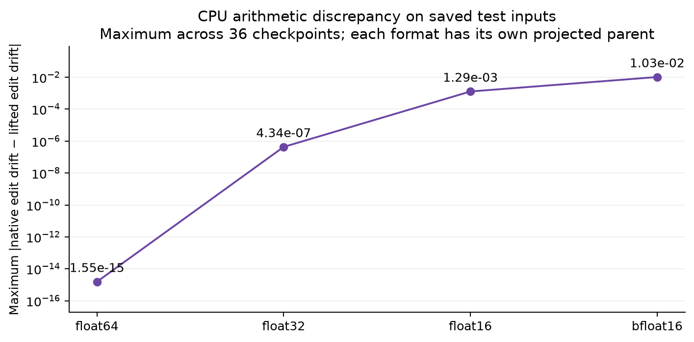
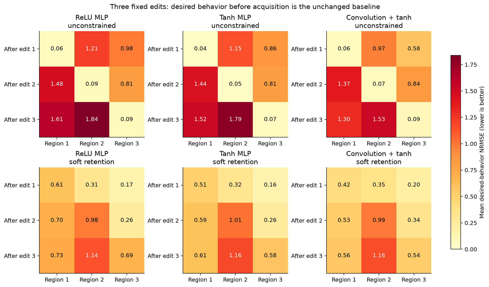

# Generic weight-space framework: saved study results

Generated from immutable saved evidence. This report evaluates deterministic fitting-allowed controls, not LLM programming. All uncertainty intervals are exploratory; no multiplicity correction is applied.

Completion: **True**. Main checkpoints: **36/36**. Complete independent worlds: **12**. Failures: **0**.

Source freeze: `0aef8bc624bc5ea501558a807c3c90afa46b3b8ab5d27ea1423943cbb986349e`. Protocol: `c809fc30b69d9fec2fd720c2e80e0d35a08d49a1dd7f6e2f352a6b78e2cbb3de`.

Interpretation, equations, and boundaries are in [methods](../../../docs/weight-space/v2/methods.md), [results discussion](../../../docs/weight-space/v2/results.md), and [limitations](../../../docs/weight-space/v2/limitations-and-next-steps.md). Exact derived values are in [summary.json](summary.json).

## Fixed arms, averaged over available checkpoints

| Arm | n | Target NRMSE | Retain NRMSE | Directional gain | Delta L2 |
| --- | --- | --- | --- | --- | --- |
| no_op | 36 | 1.000000 | 0.000000 | 0.000000 | 0.000000 |
| unconstrained | 36 | 0.038695 | 0.888351 | 0.989872 | 0.569264 |
| soft_retention | 36 | 0.360218 | 0.199321 | 0.700712 | 0.978042 |
| nullspace | 36 | 0.343031 | 0.338563 | 0.834693 | 1.334016 |
| matched_random | 36 | 1.210108 | 0.682883 | 0.001962 | 0.978042 |
| gradient | 36 | 0.383597 | 0.185988 | 0.663043 | 0.655744 |



Each family has twelve paired checkpoints. Error averages do not turn those 36 checkpoints into 36 independent task units.

## Predeclared paired contrasts

| Contrast | Worlds | Mean | Exploratory 95% interval |
| --- | --- | --- | --- |
| soft_collateral_reduction | 12 | 0.689030 | [0.674819, 0.703416] |
| soft_target_error_cost | 12 | 0.321522 | [0.299410, 0.344362] |
| soft_advantage_over_random_target | 12 | 0.849890 | [0.765373, 0.917724] |
| gradient_minus_soft_target_error | 12 | 0.023379 | [0.017805, 0.029224] |



## Validation-selected candidates

Selections: `{"gradient": 2, "nullspace": 15, "soft_retention": 19}`. Mean held-out target NRMSE: **0.345246**; retention NRMSE: **0.229042**. **36/36** also meet the validation error thresholds on test inputs. This is a descriptive threshold check, not a population guarantee or a newly predeclared success endpoint.

Structurally admitted fixed candidates: `{"gradient": 36, "matched_random": 36, "no_op": 36, "nullspace": 36, "soft_retention": 36, "unconstrained": 36}`. The selected candidate aliases an existing arm.

## Anchor feasibility

| Family | Anchors | n | Rank range | Nullity range | No-op | Exact anchor zero | Max anchor residual | Target | Retain |
| --- | --- | --- | --- | --- | --- | --- | --- | --- | --- |
| relu_mlp | 4 | 12 | [4, 4] | [21, 21] | 0 | 0 | 2.355e-16 | 0.331434 | 0.522103 |
| relu_mlp | 12 | 12 | [12, 12] | [13, 13] | 0 | 0 | 3.594e-16 | 0.432874 | 0.411429 |
| relu_mlp | 64 | 12 | [25, 25] | [0, 0] | 12 | 12 | 0.000e+00 | 1.000000 | 0.000000 |
| tanh_mlp | 4 | 12 | [4, 4] | [21, 21] | 0 | 0 | 3.889e-16 | 0.254601 | 0.359670 |
| tanh_mlp | 12 | 12 | [12, 12] | [13, 13] | 0 | 0 | 6.321e-16 | 0.387209 | 0.345725 |
| tanh_mlp | 64 | 12 | [25, 25] | [0, 0] | 12 | 12 | 0.000e+00 | 1.000000 | 0.000000 |
| conv_tanh | 4 | 12 | [4, 4] | [51, 51] | 0 | 0 | 4.695e-16 | 0.160404 | 0.247932 |
| conv_tanh | 12 | 12 | [12, 12] | [43, 43] | 0 | 0 | 5.920e-16 | 0.209009 | 0.258535 |
| conv_tanh | 64 | 12 | [55, 55] | [0, 0] | 12 | 12 | 0.000e+00 | 1.000000 | 0.000000 |



A nonzero exact endpoint residual remains nonzero even when it is tiny. Full protected rank can force a no-op; preserving sampled anchors does not establish unseen retention.

## Native precision

| Format | n | Native target | Native retain | Max drift discrepancy | Rounded cells | Requested/effective changed cells |
| --- | --- | --- | --- | --- | --- | --- |
| float64 | 36 | 0.360218 | 0.199321 | 1.554e-15 | 0 | 2520/2520 |
| float32 | 36 | 0.360218 | 0.199321 | 4.337e-07 | 2520 | 2520/2520 |
| float16 | 36 | 0.360231 | 0.199307 | 1.287e-03 | 2520 | 2520/2520 |
| bfloat16 | 36 | 0.360280 | 0.199336 | 1.034e-02 | 2520 | 2520/2512 |



These are measured CPU PyTorch results. Each format projects a separate parent; compiler features use lifted binary64 semantics. No IEEE or GPU theorem is claimed.

## Repeated edits

| Family | Method | Chains | Final target NRMSE | Prior-region interference | Exact compositions | Exact rollbacks |
| --- | --- | --- | --- | --- | --- | --- |
| relu_mlp | unconstrained | 12 | 1.178485 | 1.715786 | 12 | 12 |
| relu_mlp | soft_retention | 12 | 0.853399 | 0.304080 | 12 | 12 |
| tanh_mlp | unconstrained | 12 | 1.124716 | 1.642258 | 12 | 12 |
| tanh_mlp | soft_retention | 12 | 0.784631 | 0.285124 | 12 | 12 |
| conv_tanh | unconstrained | 12 | 0.976328 | 1.400464 | 12 | 12 |
| conv_tanh | soft_retention | 12 | 0.753396 | 0.333682 | 12 | 12 |



Requested target behavior refers to the original checkpoint; retention fits current outputs in other regions. Exact rollback restores parameters, not earlier deployed trajectories. Three edits are not a long-horizon guarantee.

## Auxiliary task controls

| Read/diagnose access | n | Correct sign | Incorrect | Abstain | Exact response | Max response error |
| --- | --- | --- | --- | --- | --- | --- |
| exact | 24 | 24 | 0 | 0 | 24 | 0.000e+00 |
| rounded3 | 24 | 0 | 0 | 24 | 0 | 7.998e-04 |

| Creation formula | Arm | n | Within tolerance | Exact response | Mean RMSE | Max error |
| --- | --- | --- | --- | --- | --- | --- |
| scaled_absolute | zero | 12 | 0 | 0 | 3.373145 | 1.140e+01 |
| scaled_absolute | random | 12 | 0 | 0 | 4.306598 | 1.385e+01 |
| scaled_absolute | analytic | 12 | 12 | 12 | 0.000000 | 0.000e+00 |
| clip | zero | 12 | 0 | 0 | 0.799402 | 1.750e+00 |
| clip | random | 12 | 0 | 0 | 3.083414 | 1.500e+01 |
| clip | analytic | 12 | 12 | 12 | 0.000000 | 0.000e+00 |

The analytic creation arm was selected a priori. Read/diagnose sign checks and formula creation are different endpoints and are not pooled into one accuracy. They measure deterministic fixtures, not mechanism discovery or autonomous synthesis.

## Accounting and boundaries

```json
{
  "main_usage": {
    "tool_calls": 708,
    "weight_values": 134148,
    "feedback_calls": 216,
    "feedback_examples": 27648,
    "execution_calls": 72,
    "execution_examples": 4608,
    "proposals": 216,
    "input_tokens": 0,
    "output_tokens": 0
  },
  "validation_model_example_executions": 55296,
  "main_test_model_example_executions": 110592,
  "feasibility_model_example_executions": 55296,
  "precision_model_example_executions": 221184,
  "sequence_model_example_executions": 24192
}
```

These counts distinguish callbacks, submitted examples, and actual model-example executions. They are not a complete FLOP or energy accounting. Provider calls and model tokens are zero.

The three families share a synthetic teacher and split design within a world. Only output heads were trained. The main-region gap is unmeasured, generic contract admission is not fully integrated, native execution and the compiler are unproved, and the new runtime candidates are not bound to generated Lean instances. See the roadmap before extending these results to live LLMs, real data, larger architectures, or deployment.

All figures are also available as SVG and PDF files beside their PNG previews. The renderer receipt records input, script, dependency, and generated-file identities.
