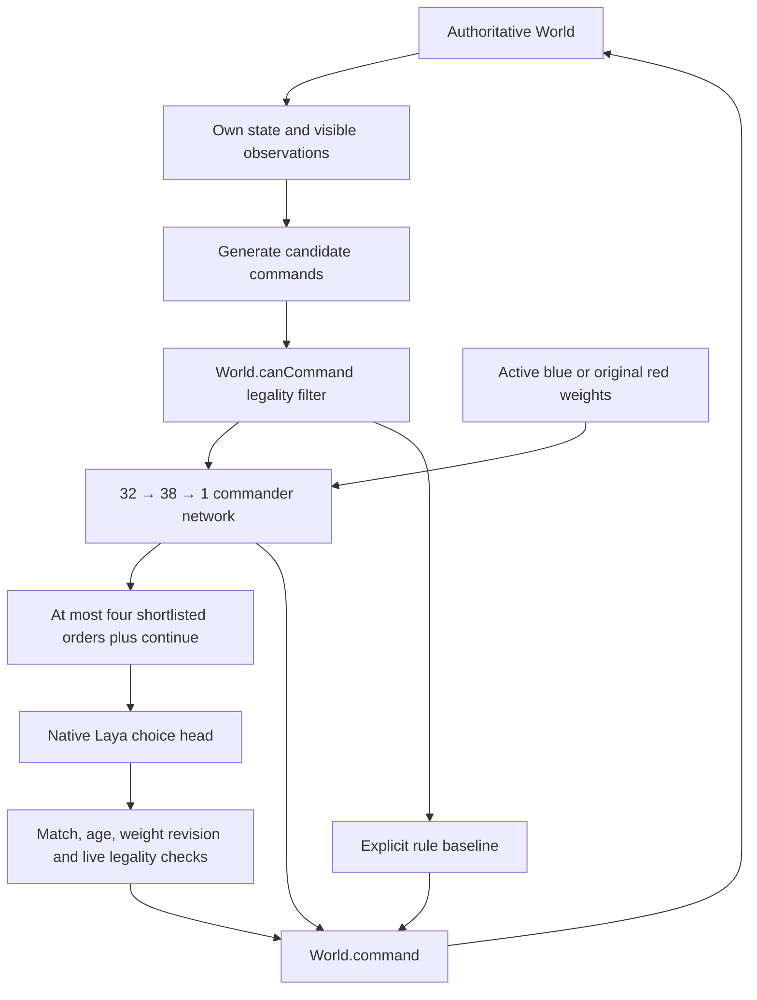

# Crown & Charter: the living world

Crown & Charter opens as an interactive civilization sandbox and weight-space learning application at **`/empires.html`**. Five societies begin in a procedural landscape, cultivate land, trade, research, send settlers and armies, and respond to changing ecological conditions. Explore beyond their starting valley, seed an independent clan, bring rain or drought, and edit the actual neural weights guiding any civilization. **Play**, **Learn**, and **Inspect** offer exploration, guided experiments, and the complete neural model. There is no prescribed victory condition in this mode.

The original unit-command RTS and its full Weight Lab remain at **`/skirmish.html`**. That mode retains gathering, construction, army orders, fog of war, four ages, and the opposing Town Center objective. Its controls, experiment worker, checkpoint format, and benchmark are documented in the [original skirmish section](#original-rts-skirmish-and-full-weight-lab).

Both modes use small **authored, untrained** auxiliary neural networks. Each living-world civilization owns a separate 1,293-parameter model that can be inspected and edited during play. Optional native Laya selects a bounded numerical proposal for that model. Laya's own encoder and checkpoint remain fixed: `models/laya-game` was trained for this repository's Cinder Station shooter, and its civilization strategy has not been validated. No gradient training runs during play.

## Run the game

From the RLCD workspace in PowerShell:

```powershell
npm ci
.\scripts\start-empires.ps1
```

Open `http://127.0.0.1:4176/empires.html`. The launcher prints the address and process IDs. The living world and manual learning experiments run in the browser without a model server. On a first visit, **Learn** opens with the live world paused and a starting point captured for the selected society. Choose **Resume world** when ready to watch decisions. Returning visits restore the remembered application mode; entering Learn pauses the world, including when Learn is restored on reload. Switching to Play or Inspect preserves the current pause state.

The application restores a valid local world save when one exists; otherwise it begins with seed 42. Open **World settings and saves** to save, import, restore a backup, or generate another seed. The original RTS is available at `http://127.0.0.1:4176/skirmish.html` on the same server.

To use an existing local checkpoint:

```powershell
.\scripts\start-empires.ps1 -WithLaya -Checkpoint trained
```

This requires `.venv/Scripts/python.exe` and the complete checkpoint directory `models/laya-game`, including `model.safetensors`, configuration, and tokenizer files. After the server is ready, select a civilization, choose **Inspect → Live weights**, expand **Ask native Laya for a numerical edit**, and choose **Ask Laya**. In the original skirmish, use its **Laya · experimental** commander or the full Weight Lab's **Ask Laya** button. The default API address is `http://127.0.0.1:8768`.

For a fresh environment with the published base checkpoint, install the prerequisites listed in [the repository README](../README.md), then run:

```powershell
.\scripts\setup.ps1
.\scripts\start-empires.ps1 -WithLaya -Checkpoint base
```

Setup installs the pinned Python/runtime dependencies, JavaScript dependencies, and the base checkpoint in `models/laya`. It does not produce an RTS-trained checkpoint or restore `models/laya-game`. Both checkpoint choices are experimental for RTS. The setup script requires `git`, `uv`, `npm`, and `node` and downloads dependencies and model files.

Use `-WebPort` and `-ApiPort` to choose different, distinct ports. The launcher verifies an occupied port before reuse and reports conflicts. It starts hidden local processes and writes logs and process manifests under `artifacts/empires/runtime-trained` or `artifacts/empires/runtime-base`; the web process manifest is `artifacts/empires/web-<port>.json`.

`npm run dev:empires` is also available for frontend development. For Laya, prefer the launcher: it sets the Vite proxy's `RLCD_API` to the isolated RTS service instead of the repository's default shooter API port.

## Choose Play, Learn, or Inspect

All three modes use the same live world and selected civilization. Switching modes retains your applied weight edits.

| Mode | What to use it for |
| --- | --- |
| **Play** | Explore, follow societies, change map layers, seed clans, and shape the environment. **Shape their behavior** opens Learn for the selected society. |
| **Learn** | Follow five lessons, predict an edit's effect, move one real weight, compare choice probabilities at a captured state, and simulate two possible futures. Entering this mode pauses the live world; its **Resume world** control lets it run alongside the lesson. |
| **Inspect** | Open the complete Society, Live weights, and History panels; edit every tensor, trace the forward pass, restore a mind revision, or ask native Laya for a numerical proposal. |

Learn starts with plain-language observations and exposes the arithmetic under **Why did that happen?**. The five lesson stops are **Observe**, **Edit**, **Compare**, **Reflect**, and **Inspect**. They can be visited in any order. **Mark explored & continue** records progress after the relevant interaction; predictions receive descriptive feedback without a correctness score. The final lesson returns to Play. A vocabulary disclosure explains agents, observations, weights, activations, scores, probabilities, checkpoints, and paired experiments.

The lab links to the [Weight-Space Programming article](https://rikiyat.github.io/blog/weight-space-programming/) as a conceptual reference. This application teaches manual edits to an auxiliary network and tests their consequences in a simulated world. Specification-to-weight synthesis by a pretrained language model remains outside this implementation.

## Explore and shape the living world

The opening societies have different authored priorities: agrarian growth, commerce, forest conservation, military activity, and knowledge. Choose **12×** or **32×** to observe longer histories, then pause to inspect a particular moment. One year is 48 simulation seconds, with four 12-second seasons. The live simulation uses fixed 0.25-second steps and advances only while the browser tab is visible; it does not calculate years of offline progress when you return.

| Input or control | Action |
| --- | --- |
| Play / Learn / Inspect | Switch between exploration, guided experiments, and the full inspector |
| Drag the map; WASD / arrow keys | Pan across the landscape |
| Wheel, touch pinch, + / −, or zoom buttons | Zoom |
| Click a town or its label | Select its civilization and settlement; show its panel when in Inspect |
| Click a civilization banner | Center on a settlement and select its society |
| Regional atlas click | Move the camera to that place |
| H / atlas home button | Return to the first settlement |
| Space with map focus / pause button / Learn's Resume world | Pause or resume live time |
| 1×, 4×, 12×, 32× | Set simulation speed |
| Map selector | Show living terrain, civilization territory, land fertility, or wildlife |
| Learn's society selector / Find on map | Choose a decision maker and locate its settlement or traveling group |
| Learn panel header's collapse / expand button | Collapse or expand the learning panel |
| Learn weight control's − / + buttons | Decrease or increase the selected W2 coefficient by 0.1 |
| Seed a clan, then click land | Find a nearby viable site for an independent society |
| Nature | Inspect ecology, choose a local intervention, or change recovery settings |
| Chronicle / latest story | Read events and travel to where they happened |
| Escape | Close the inspector, collapse Learn, and finish the active placement or intervention |
| World settings and saves | Save, export, import, restore a backup, change dynamics, or generate a world |

Select a civilization, then choose **Inspect** to access **Society**, **Live weights**, and **History**. Society shows its settled population, food stores, treasury, knowledge, cohesion, settlements, people traveling in groups, and diplomatic relationships. History follows events associated with that civilization. The general Chronicle retains recent world events and can focus the camera on an event's location. Nature, Chronicle, and settings open their respective panels in Inspect; choosing a placement or environmental intervention switches to Play.

Inspect leaves the current pause state unchanged. Help, import, and new-world dialogs temporarily suspend simulation while open. Form, learning-panel, and inspector input is isolated from map keyboard controls. **Observe** closes the current tool, switches to Play, and returns map clicks to society selection.

**Nature** offers rain, reforestation, drought, and wildlife restoration. Choose a tool and click land; it affects the selected ecological region and its eight neighbors, with reduced strength in the neighbors. The tool remains active for further clicks until Escape or Observe. Rainfall, forest recovery, wildlife recovery, civilization emergence, and conflict pressure can each be adjusted from 0× to 2× in the relevant panels.

## Societies and ecology

Each society chooses among eight endeavors every four simulation seconds: **cultivate, expand, conserve, trade, research, fortify, raid, and migrate**. The chosen focus affects settlement activity. The simulation checks the required population, resources, destinations, and capacity before launching a group or carrying out a conditional action; selecting an endeavor does not guarantee that every associated action can happen immediately.

| System | Implemented behavior |
| --- | --- |
| Land | Coordinate-based terrain with rivers, coasts, woodland, fertile plains, dry areas, hills, and snow; season-dependent presentation |
| Ecology | Moisture, forest recovery and loss, soil fertility, land pressure, fire, herbivore populations, and predators interact within stored regions |
| Settlements | Food production and consumption, hunting, farms, wealth, taxation, births, deaths, health, unrest, and settlement levels |
| Civilization development | Knowledge advances through five ages; cohesion responds to society conditions |
| Commerce | Caravans carry people and food, exchange goods at peaceful settlements, and return home; commerce changes trust |
| Diplomacy and conflict | Neutral, trade, alliance, and war relationships; army expeditions resolve raids, casualties, looting, and possible ownership changes |
| Expansion and migration | Settlers and refugees travel from existing populations, establish settlements, or join safer settlements |
| Independent societies | Low-cohesion migrating groups can found a new civilization; sufficiently distant colonies with high unrest can secede under the emergence rules |
| Decline | Hunger, ecological damage, and conflict can reduce populations, abandon settlements, or end a civilization while its record remains in history |

People and carried food are removed from their source settlement when a group departs. Travel, settlement, return, and casualties update those quantities in the simulation. Offshoot civilizations receive detached copies of their parent's current neural model, so editing an offshoot does not rewrite the parent's mind.

The world is a macro simulation of populations and groups. Village buildings, villagers, and wildlife are visual representations of those quantities; every rendered person or animal is not an independent agent. Traveling groups have actual simulation positions. Their routes are direct segments with slower water crossings, and combat resolves at arrival. Fine-grained formations, tactical navigation, naval simulation, detailed per-civilization technology trees, campaigns, and multiplayer remain expansion work.

## Learn through a live weight experiment

The learning panel separates **live conditions**, a **frozen probability comparison**, and **sampled future outcomes**. The society card shows current people, settlement food stores, food need, land pressure, and the last chosen endeavor. Its population includes travelers. The probability bars instead use the observations at the labeled starting point, even when the live world has advanced.

1. Select a society in **Learn**. The application captures its current world, original model, local observations, and random state. **New starting point** captures them again, makes the current model the new original, and clears previous comparison results.
2. Choose an endeavor under **Shape a priority** and predict **More likely**, **Less likely**, or **About the same**. Move the slider to edit the displayed real `W2[index]` coefficient. The adjacent **−** and **+** controls decrease or increase that coefficient by **0.1**. The edit applies immediately to the live model; its next endeavor is sampled at the next scheduled decision, every 16 ticks or four simulated seconds. **Restore this weight** returns only this coordinate to its captured original value.
3. Read the **Original → Edited** choice probabilities. Both complete models receive the same captured observations. The immediate difference therefore isolates the model changes at that state. **Why did that happen?** shows hidden activation × output weight, that neuron's score contribution, total candidate score, and temperature. After W1 or b1 edits, a named priority neuron can respond to several candidates or none; the actual trace determines its effect.
4. Choose **1, 3, 5, or 10 years** and press **Compare futures**. A background worker advances two detached copies of the captured world for the same duration, using the original model in one and the currently edited model in the other. The live world keeps its own state and applied edits. **Cancel** stops the worker. You can run an unchanged model as a control comparison.
5. Compare the outcome chart, final-value table, and **Which endeavors were chosen?** counts. Try at least two measures, then another checkpoint or seed. **Reproduce this comparison → Download experiment + starting world** saves the complete experiment for analysis.

The candidate model is captured when the run begins. Further edits or a changed duration label the completed result as describing an earlier experiment; rerun to test the current choices. Selecting another society, replacing the world, or capturing a new starting point clears the previous checkpoint and results and cancels an active comparison. Switching modes alone retains the current checkpoint. Pausing the live world does not prevent the worker from finishing a comparison.

### Read the outcomes precisely

The chart follows population, food, knowledge, forest, or wildlife at quarter-year intervals. The final table also shows soil fertility, with **Difference = Edited − Original**. Population includes settled and traveling people. Experiment food includes settlement stores and carried supplies, while the live card's **food stored** shows settlement stores alone. Measures follow the selected society; independent descendant societies are excluded from its totals.

Forest cover and fertility are averages, and wildlife is a total, over the same ecological regions occupied by that society's settlements or traveling groups at the starting point. They are not averages over newly acquired territory or the entire procedural landscape. If an original region retires or is regenerated, subsequent cohort measurements are unavailable; freshly generated terrain does not substitute for the missing history. Missing society metrics display **Unavailable** when the record has retired. Results also flag extinction and reached region, society, settlement, or mobile-group caps.

Decision counts record scheduled endeavor selections. They do not count preview calculations or prove that a farm was built, a caravan arrived, or an attack succeeded. Resources, destinations, and finite world capacity can block the selected action. Both branches begin with the same world and random state, but different choices can change later random draw sequences. One paired run provides a reproducible scenario; broader claims require more checkpoints or seeds. Neither the comparison nor the progress checklist trains the policy or establishes strategic improvement.

The version-1 `crown-charter-learning-bundle` JSON contains the request's starting world, civilization ID, original and edited models, and duration, plus the measured result. The result includes initial and final observations, quarterly trajectories, scheduled decision counts, ecological cohort keys, warnings, seed, tick range, initial random state, and content fingerprints. Fingerprints aid comparison and are not cryptographic signatures. The exported `request` can be passed to [createLearningExperiment](../game/src/world/learning-experiment.ts) to reproduce the run. Use **Export world** for a file accepted by the gameplay session importer; experiment bundles have their own format.

## Edit a civilization's live weights

Use Learn's single-priority control for guided edits, or choose **Inspect → Live weights** for the complete model. The inspector's eight **Neural priorities** sliders write the first eight actual W2 coefficients, one per endeavor. Edits apply immediately to that civilization and affect its next scheduled decision. The current endeavor can therefore remain visible until the next decision; the inspector's ranking bars recompute from the edited model and current state. Learn's Original and Edited bars remain pinned to its captured observations.

Here, weight-space programming operates on the small auxiliary model: the stored tensors are the editable program and the numbers executed by the policy. Native Laya is a separate, unchanged selector that can choose one of the numerical proposals described below.

Every candidate uses the same real matrix forward pass:

```text
x = [16 local state features, 8 action indicators, 8 reserved zeros]
h = ReLU(W1 × x + b1)
score(action) = W2 · h + b2
p(action) = softmax(score(action) / temperature)
```

The local features describe food need, fertility, forest, pressure, health, unrest, cohesion, wealth, knowledge, development, crowding, trade opportunities, threats, army strength, frontier room, and migration need. The living world samples its next endeavor using the saved seeded random state and the displayed softmax distribution. These bars express choice probabilities, not predictions of success. Temperature changes how concentrated the sampled decisions are; the shared output bias b2 shifts every score equally and leaves the probabilities unchanged.

| Tensor or setting | Shape / count | Accepted finite values |
| --- | --- | --- |
| W1 | 38 × 32 = 1,216 | −64 to 64 |
| b1 | 38 | −64 to 64 |
| W2 | 38 | −64 to 64 |
| b2 | 1 | −64 to 64 |
| Temperature | 1 additional scalar, outside the 1,293-parameter count | 0.05 to 20 |

Expand **Edit all 1,293 parameters** to select a W1 heatmap cell or enter a tensor coordinate. Row and column indices start at zero. Choose the tensor, enter a value, and use **Apply parameter live**. The full matrix is executed, including entries that start at zero. Eight reserved inputs currently remain zero, so their W1 columns do not influence decisions until the feature schema is extended.

**Cultural starting points** offers Agrarian growth, Merchant cities, Forest stewards, Martial frontier, Scholarly cities, and Balanced council. **Apply** changes the eight action-priority W2 entries and temperature while retaining other tensor edits. Presets describe authored numerical preferences; applying one is not a training run or a validated strategy improvement.

Expand **Why this action? Inspect the forward pass** to select an action and see normalized observations, hidden activations, output weights, and their contributions to its score. **Mind checkpoints & restore** can show the current model JSON, import validated model JSON, or restore a retained revision. Model imports check labels, dimensions, supported fields, and finite bounds before application; the text limit is 250 KB. Each mind retains its starting snapshot plus recent changes, up to 20 snapshots. Rapid edits to the same control may be combined into one revision before that revision is used by a decision. Restore applies the saved model as a new revision.

Living-world minds and original skirmish checkpoints have different feature schemas and import formats. Use a living-world model with this panel and a full world export to keep its civilization context. The living world's Learn mode provides frozen comparisons and background paired futures; its weight edits always apply live. The original skirmish's full Weight Lab retains its separate staged-edit workflow, mutation search, and tournament experiments.

## Native Laya in the living world

**Ask Laya** submits the selected civilization's compact observation and explicit numerical alternatives to `/api/empires/weight-patch`. The fixed native `choice` head selects from at most three authored patches plus **keep**:

| Proposal | Changes to the current civilization's W2 values |
| --- | --- |
| `sustain` | Cultivate priority +0.75; conserve priority +0.50 |
| `connect` | Trade priority +0.70; research priority +0.50 |
| `secure` | Fortify priority +0.65; migrate priority +0.40 |
| `keep` | Keep the current model without creating a revision |

Each patch changes at most two coefficients. Targets are capped at 64, rounded to six decimal places, and omitted when they would make no numerical change. The server returns the selected submitted patch. Laya chooses among these alternatives; it does not generate arbitrary tensor values, directly command the society, or update its own checkpoint.

A nonempty patch applies immediately after the client validates the native choice, probabilities, timings, checkpoint provenance, request identity, and exact numerical edits. The source model revision and fingerprint must still match. Changing the selected civilization or replacing the world cancels the request; replies also expire after 60 world ticks, or 15 simulation seconds. The wall-clock timeout is 20 seconds. Pause or reduce world speed when inspecting a pending native result, since high speed can make the observation stale before it arrives.

Errors and retained-weight choices appear in the panel. Server prediction records use the same `<artifact_dir>/empires/weight-decisions.jsonl` path as the skirmish coach. A logged native selection can later expire at the client, so server predictions alone do not prove that a patch was applied. The world save preserves applied models and revision labels; it is not a complete native-request evaluation log. There is no background validation tournament or automatic training step in the living-world coach. Learn's paired futures are separate local experiments and make no native Laya call.

## Save, reload, export, and backup

**World settings and saves → Save this moment** writes the current session to this browser's `localStorage`. Automatic saves run every 15 seconds while the page is active; hiding or leaving the page also attempts a save. Reload restores a valid saved world, including simulation tick and random state, stored ecology, civilization and settlement records, mobile groups, diplomacy, recent events, settings, each mind and retained revisions, camera position, selection, layer, pause state, and speed. Opening in the remembered Learn mode then pauses the world, even if the session was saved while running.

Learning preferences use the separate `crown-charter-learning-v1` key. It stores the chosen mode, current lesson, and explored lesson IDs for this browser origin. It does not store a prediction, captured experiment checkpoint, or completed results. Reloading Learn captures a fresh starting point from the restored world; download an experiment bundle before leaving to retain its original checkpoint and results. Lesson progress is independent of the current world and is not included in world exports. If learning-progress storage fails, the lessons remain usable for the current visit and the application reports the failure.

**Export world** downloads a version-1 `crown-charter-world-session` JSON file. **Import world** accepts a file or pasted JSON, validates the entire session before replacement, and then installs it. The world-file limit is 12 MB. Export is the way to keep several worlds or move a world to another browser profile or device; local storage is tied to the current browser origin, including its port.

Before an import or **Generate another world**, the current world is written to the single previous-backup slot. **Restore previous backup** loads it and makes the world you just left the new backup. The keys are `crown-charter-living-world-v1` and `crown-charter-living-world-backup-v1`. The separate skirmish weight session is unaffected.

An unreadable stored session is preserved, and automatic writes remain disabled while a temporary seed-42 world is shown. A valid import or explicit new-world generation can replace it after keeping the protected data in the backup slot. Storage failures remain visible; **Export world** provides a file even when browser storage is unavailable. No cloud synchronization or offline simulation is implemented.

## Expanding terrain and bounded state

Terrain is generated from the seed and world coordinates as the camera travels, using 48-unit chunks and a floating render origin. There is no fixed skirmish-sized battlefield edge. Supported coordinates are finite and bounded to one billion world units, with the camera clamped slightly inside that range for streamed terrain. Nearby render chunks are created and retired as needed.

The expanding landscape does not mean unbounded persistent simulation. These limits keep the active state finite:

| Stored state | Limit |
| --- | ---: |
| Ecological regions | 2,048 |
| Retained civilization records | 32 |
| Retained settlement records | 128 |
| Concurrent mobile groups | 128 |
| Recent world events | 200 |
| Mind snapshots per civilization | 20 |

Stored regions continue their ecology updates even when outside the rendered view. Regions currently occupied by settlements or mobile groups are protected when the region cache fills. Other regions can be retired; returning to retired land regenerates its baseline ecology from the seed, so remote interventions and ecological history are not retained forever. Population and wildlife totals describe stored simulation state, not every possible coordinate in the procedural landscape.

At the civilization or settlement cap, abandoned towns retire only when no traveling group needs their origin or destination. Extinct societies then retire when no retained settlement or group references them. This frees capacity for new founding, colonies, and secession while keeping the arrays bounded. Recent chronicle text survives, but retired societies no longer have an inspectable mind or ancestry link; obsolete diplomatic relations are removed. IDs are never reused. If humanity disappears entirely, at least one extinct archive record remains for save compatibility, ecology continues, and **Seed a clan** can introduce people again.

## Living-world implementation and checks

| File | Responsibility |
| --- | --- |
| [types.ts](../game/src/world/types.ts) | Society, ecology, group, diplomacy, mind, event, and save types |
| [terrain.ts](../game/src/world/terrain.ts) | Deterministic coordinate-based terrain and biome sampling |
| [simulation.ts](../game/src/world/simulation.ts) | Authoritative fixed-step world, resource and population changes, bounded state, saves, and validation |
| [policy.ts](../game/src/world/policy.ts) | Authored per-civilization networks, local observations, real forward passes, presets, traces, and validated tensor edits |
| [coach.ts](../game/src/world/coach.ts) | Native numerical proposals, request cancellation, exact patch validation, and stale-model guards |
| [storage.ts](../game/src/world/storage.ts) | Versioned world-session serialization and view-state validation |
| [inspector.ts](../game/src/world/inspector.ts) | Society, ecology, history, mind, and save panels |
| [learning.ts](../game/src/world/learning.ts) | Play/Learn/Inspect modes, captured comparisons, live edits, lesson progress, experiment lifecycle, charts, and export |
| [learning-content.ts](../game/src/world/learning-content.ts), [learning.css](../game/src/world/learning.css) | Five lessons, endeavor explanations, vocabulary, accuracy notes, and responsive learning-panel presentation |
| [learning-experiment.ts](../game/src/world/learning-experiment.ts), [learning-worker.ts](../game/src/world/learning-worker.ts) | Validated paired world copies, scheduled decision counts, fixed ecological cohorts, quarterly measurements, reproducibility, and background execution |
| [main.ts](../game/src/world/main.ts) | Input, time scheduling, session replacement, autosave, atlas, and UI lifecycle |
| [view.ts](../game/src/world/view.ts), [scenery.ts](../game/src/world/scenery.ts) | Streamed Three.js terrain, instanced scenery, camera, map layers, picking, and disposal |

Run the repository checks from the workspace root:

```powershell
npm test
npm run build
.\.venv\Scripts\python.exe -m pytest tests/test_empires.py
```

The living-world test files cover the simulation, policy and native-coach contracts, session loading, and CPU-side renderer geometry/lifecycle behavior. Headless geometry tests do not exercise WebGL rendering, and controlled endpoint responses do not establish a real checkpoint's strategic quality. The tournament documented below measures the original skirmish only. The build has separate entry pages for Cinder Station, the living world, and the original skirmish.

The [living-world verification report](../artifacts/empires/living-world-verification.md) records the 259-test repository run, production build, browser interactions, responsive screenshots, exact UI export/import roundtrip, native retained-weight result, and measured limitations. The [completion audit](../artifacts/empires/living-world-completion-audit.md) maps the requested capabilities to this evidence and distinguishes the implemented auxiliary-weight programming from future model synthesis or training.

The [long-run organic audit](../artifacts/empires/living-world-organic-audit.json) advanced untouched default seeds 11, 42, and 2026 for 250 elapsed years each. All three grew from five founding societies to 32 living civilizations and 128 settlements, with 27 autonomous new societies per seed. First offshoots appeared after 49–54 elapsed years. Ecology changed within the same original regions, all finite-state checks passed, and complete saves resumed deterministically. Each run reached the society and settlement caps; none showed civilization collapse or record retirement. These finite runs establish organic emergence and ongoing dynamics, without establishing perpetual expansion or repeated rise-and-fall cycles.

## Original RTS skirmish and full Weight Lab

Open **`/skirmish.html`** for the original RTS vertical slice. Choose **Found your kingdom** for manual play or **Watch the neural commanders** for a local neural-versus-neural match. Its seed field controls the finite battlefield, with seed 42 as the default. The following controls, network features, experiments, persistence formats, and benchmark all refer to this mode.

### Play and inspect

Blue starts with a Town Center, house, barracks, six villagers, and two spearmen. The villagers already have gathering orders. Train additional villagers, add houses before reaching capacity, establish farms, advance through the ages, and destroy every opposing Town Center. The red opponent always uses the original authored neural commander, independently of blue's weight edits.

| Input | Action |
| --- | --- |
| Left click | Select a unit or building; inspect a resource |
| Left drag | Select your units in a box |
| Shift + click or drag | Add to selection |
| Right click | Gather a visible resource/farm, attack a visible enemy, or move |
| Middle or right drag | Pan the camera |
| WASD / arrow keys | Pan the camera |
| Mouse wheel / zoom buttons | Zoom |
| Minimap click | Move the camera |
| H | Center and select your Town Center |
| I / M | Select idle villagers / your army |
| B | Open the building panel |
| V | Train a villager when the context offers that action |
| F / G | Choose attack-move / move, then click a destination |
| X | Stop selected units |
| Space | Pause or resume |
| Escape | Close the Weight Lab first; otherwise cancel placement/order, close help, or toggle pause |

Use the context, building, and technology panels for production, placement, and upgrades. Construction previews show whether a site is legal. The speed button cycles through 1×, 2×, and 4× simulation speed. Help pauses the match while open.

The blue commander selector offers **You · manual command**, **Editable neural commander**, **Rule baseline**, and **Laya · experimental**. The neural commander decides every two simulation seconds using blue's current applied weights. Manual mode still displays optional neural advice using those weights; the rule controller follows its own scoring rules. A successful manual command takes control back from an automatic commander. The probability bars are the active model's relative preference among its candidates; they are not probabilities of winning.

Open **Weight Lab** to inspect or change the running commander. The button displays its active revision, such as `r3`. Opening the lab leaves the simulation running; use **Pause** when you want to inspect a fixed state. Keyboard and pointer input inside the lab are isolated from battlefield orders.

### Implemented scope

| Area | Current implementation |
| --- | --- |
| World | Seeded 64 × 64 map, central river and two crossings, resource patches, exploration and fog of war |
| Simulation | Fixed 0.1-second steps, renderer-independent state, validated command API, grid navigation around terrain and building footprints |
| Economy | Food, wood, gold, stone; worker gathering, carrying and Town Center drop-off; finite farm food; construction; population reservations for queued units; hard capacity of 100 per player |
| Ages | Frontier, Feudal, Citadel, Imperial; resource costs and advancement timers |
| Units | Villager, spearman, archer, knight, siege ram |
| Buildings | Town Center, house, farm, barracks, archery range, stable, watchtower, forge and siegeworks, castle |
| Technology | Wheelbarrow, tempered weapons, forged armor |
| Combat | Direct attack and attack-move, unit counters, ranged attacks, defensive buildings, siege damage, Town Center victory condition |
| Presentation | Procedural Three.js isometric world, minimap, box selection, placement previews, resource/population/age HUD, commander panel, match result screen |
| Weight Lab | Live and staged editing of every tensor, current-state comparisons, feature/activation traces, presets, revision history, checkpoint import/export and browser persistence |
| Experiments | Seeded W2 mutation search in a background worker, paired sides, separate development/validation seeds and guarded promotion |
| Evidence | Local decision timings, native Laya action and weight-patch evidence, weight revisions and experiment results in the debug match export, seeded headless tournament |

This is a foundation for a larger RTS. There are no civilization-specific technology trees, walls and gates, naval units, campaign editor, multiplayer, saved-game loader, or rendered replay viewer. Navigation and combat are intentionally simple, and the current commanders often fail to finish a match. The procedural visuals are original game assets rather than imported Age of Empires artwork.

### Code and control boundary

| File | Responsibility |
| --- | --- |
| [types.ts](../game/src/empires/types.ts) | Unit/building definitions, prices, ages, commands and state types |
| [simulation.ts](../game/src/empires/simulation.ts) | Authoritative economy, navigation, production, combat, visibility and victory |
| [policy.ts](../game/src/empires/policy.ts) | Observable features, legal macro candidates, matrix inference, rule baseline and Laya shortlist |
| [commander-v1.json](../game/src/empires/weights/commander-v1.json) | Literal network matrices, biases, feature labels and provenance |
| [weight-runtime.ts](../game/src/empires/weight-runtime.ts) | Tensor validation, immutable snapshots, revisions, baselines, checkpoints, presets and bounded numerical proposals |
| [weight-lab.ts](../game/src/empires/weight-lab.ts) | Live comparison, tensor editors, experiment controls and history UI |
| [weight-workbench.ts](../game/src/empires/weight-workbench.ts) | Applied/staged edits, browser persistence, worker lifecycle, promotion and match weight evidence |
| [weight-experiments.ts](../game/src/empires/weight-experiments.ts), [weight-worker.ts](../game/src/empires/weight-worker.ts) | Seeded W2 mutations, independent paired matches, development selection, validation and fitness gate |
| [weight-coach.ts](../game/src/empires/weight-coach.ts) | Native Laya numerical-patch requests, exact response validation, cancellation and stale-revision guards |
| [laya.ts](../game/src/empires/laya.ts) | Immutable candidate snapshots, request lifecycle and response validation |
| [empires.py](../rlcd/empires.py) | Native Laya action and weight-patch endpoints, tokenizer packing audit and evidence logging |
| [main.ts](../game/src/empires/main.ts) | Input, controller scheduling, HUD and export |
| [view.ts](../game/src/empires/view.ts) | Three.js world rendering and picking |
| [empires-benchmark.ts](../scripts/empires-benchmark.ts) | Headless paired-side neural-versus-rule tournament |



The model chooses a bounded macro such as assigning workers, starting construction, queuing a unit, advancing an age, or moving an army. The simulation owns resource deduction, build time, movement, damage, visibility, and victory. A model response cannot execute code or bypass `World.command` validation.

Enemy units and resource nodes are available to the policy only when visible; the policy does not read the opponent's hidden resource totals, production queues, or army. The attack-move destination toward the opposite settlement uses a documented symmetry prior about this map. If that point is blocked, the same assault macro probes nearby cell centers within six tiles using ordinary command-legality results. It chooses the closest legal point, with deterministic ties favoring the home side, without inspecting the identity of hidden occupants. That symmetry prior should become a scouting belief for maps with varied starting positions.

### What weight-space programming means here

The user-supplied article, *Sparks of Weight-Space Programming: LLMs can natively read & write neural network weights* (November 2, 2026), motivates treating small weight tensors as an editable program. The concrete adaptation here is an auxiliary RTS commander with an actual matrix forward pass. It is not a rewrite of Laya's pretrained encoder weights.

For every generated legal candidate `a`, construct a 32-element feature vector `x(s, a)`:

```text
h_j = max(0, b1_j + sum_i W1[j, i] × x_i)
score(s, a) = b2 + sum_j W2[j] × h_j

p(a | s) = exp((score(s, a) - max_score) / temperature)
           / sum_b exp((score(s, b) - max_score) / temperature)
```

`W1` has shape 38 × 32, `b1` has 38 entries, `W2` has 38 entries, and `b2` is a scalar: **1,293 neural parameters** in total. Temperature is a separate editable scalar, initially 1.2. The code executes all matrix entries, including zeros. Softmax is evaluated only over generated legal candidates, using the maximum-score subtraction for numerical stability. The commander chooses the highest score, with stable candidate-ID tie-breaking; it does not sample from the displayed distribution.

The first 16 features describe resource shortages, idle workers, worker deficit, population pressure, army readiness, visible threats, production, age progress, surplus resources, visible army advantage, army deficit, the candidate's coverage gap, and disruption to current orders. The remaining 16 mark the candidate's action family. Feature names and order are stored with the weights and matched by `policyFeatures`.

A concrete programmed unit is:

```text
food_shortage = clamp(1 - food / 240, 0, 1)
h_food = ReLU(food_shortage + is_gather_food - 1)
score contribution = 5 × h_food
```

For a food-gathering candidate, this activates in proportion to the food shortage. For another action, it stays at zero. Other hidden units encode population pressure, production coverage, defense urgency, and an order-disruption penalty. The resulting weights are prior knowledge expressed numerically. They were authored without a dataset, optimizer, gradient updates, or training run; the JSON provenance and UI preserve that fact.

Candidate generation is also a substantial part of the policy. It finds construction sites and available producers, preserves current builders, prefers idle workers, reassigns at most one active gatherer, and sends idle reserve troops on assaults. It stops proposing houses at the hard population cap and counts only food-bearing farms as productive. This is a hybrid of authored features, authored action generation, and neural scoring, rather than an end-to-end learned RTS player.

To inspect a real decision using the original authored checkpoint from the workspace root:

```powershell
@'
import { World } from './game/src/empires/simulation.ts';
import { MODEL_METADATA, rankActions } from './game/src/empires/policy.ts';
const world = new World(42);
console.log(MODEL_METADATA);
console.table(rankActions(world, 0).map(({ id, score, probability }) => ({ id, score, probability })));
'@ | node --import tsx --input-type=module -
```

### Live Weight Lab

The lab has four views: **Live**, **Tensors**, **Experiments**, and **History**. Its identity strip shows the applied revision, content fingerprint, provenance, architecture, and parameter count. While open, it refreshes the current tick, simulation time, pilot, and rankings approximately every half second; an edit refreshes it immediately.

Each reference model has a specific purpose:

| Model | Used for | When it changes |
| --- | --- | --- |
| Active blue revision | Blue neural decisions, manual neural advice, and Laya's action shortlist | An applied edit, preset, import, restoration, accepted Laya patch, or experiment promotion |
| Pinned comparison baseline | Side-by-side scores for the same current legal candidates | **Pin baseline** captures the current active revision |
| Original red commander | The opposing player in the live match | Remains the original authored checkpoint |
| Experiment starting model | The frozen opponent throughout one background run | Captured from blue's active revision when that run starts |

**Live** compares active and baseline scores and softmax probabilities for the same candidates in the current world. It shows the first six rankings initially; **Show all candidates** expands the list. Select a candidate to see its 32 input features and 38 hidden-neuron contributions for both models. Contribution tooltips include the preactivation, ReLU activation, and W2 coefficient. **Pin baseline** lets you retain a reference before making changes without changing the red player.

The semantic sliders and number fields write actual W2 coefficients. The default **8 essentials** filter can switch to **All neurons**, **Economy**, **Military**, **Progression**, or **General**. Positive output weights reward an activation; negative weights penalize it. A neuron's strategic label describes its authored purpose; editing its W1 row or b1 can change what activates it.

**Strategy preset** offers **Authored balance**, **Economic growth**, **Early pressure**, **Hold the frontier**, **Technology race**, and **Frontier intelligence**. **Use preset** writes the profile's displayed absolute targets for all 38 W2 entries. Presets retain your W1, b1, b2, and temperature, so **Authored balance** restores the output profile only. These are authored numerical profiles whose strategic quality has not been trained or established by a benchmark.

**Tensors** exposes every parameter:

| Control | Shape | Entries | Valid finite range |
| --- | --- | ---: | --- |
| W1 | 38 neurons × 32 features | 1,216 | −64 to 64 |
| b1 | Hidden bias vector | 38 | −64 to 64 |
| W2 | Output weight vector | 38 | −64 to 64 |
| b2 | Shared output bias | 1 | −64 to 64 |
| Temperature | Softmax scalar, separate from the neural parameter count | 1 | 0.05 to 20 |

Choose a W1 heatmap cell, use the labeled neuron and feature selectors, or move the selected cell with arrow keys. Enter focuses its value editor. The tensor buttons also expose the vectors and scalars. Valid numeric input writes the selected value; **Write value** provides an explicit button for the same operation. **Use baseline value** copies that one scalar from the pinned baseline. Temperature changes the displayed probability distribution but cannot change deterministic argmax by itself. The shared b2 shifts every candidate score equally, so it also leaves the ordering unchanged by itself.

**Apply edits live** is checked initially. Each valid manual or preset change applies to blue as a new revision and affects its next neural decision. It does not modify the checked-in `commander-v1.json`. No-op UI edits create no revision. Uncheck the switch to collect edits in a draft; **Apply** commits all changed numbers atomically, and **Discard** abandons the draft. With a draft present, editors show staged values while rankings and forward-pass traces continue to describe the applied active model. Apply or discard the draft before changing the editing mode, pinning a baseline, restoring/importing a checkpoint, starting an experiment, or asking Laya.

**History** retains the latest 40 snapshots by default. Successful applications, imports, and restorations advance a monotonically increasing revision number. **Undo** restores the previous retained snapshot as a new revision; a history entry's **Restore** also creates a new revision rather than rewinding the counter. Each snapshot holds detached immutable tensors, source, reason, tick, parent revision, timestamp, and fingerprint. A pinned baseline survives history eviction. See [Exports and persistence](#exports-and-persistence) for checkpoint files and automatic browser storage.

### Background weight experiments

In **Experiments**, configure the search and choose **Run mutation search**. A dedicated browser worker runs fresh independent simulations while the live game can continue. One run makes a bounded set of W2 mutations; it does not edit W1, b1, b2, or temperature. Consecutive candidate pairs use opposite seeded perturbations, clipped to the tensor limits, with unchanged boundary edits reflected inward. There are no recursive search rounds or gradient updates.

| Setting | Default | Accepted values |
| --- | --- | --- |
| Candidates | 2 | 1–16 |
| Seconds per match | 90 | 0.1–600 simulation seconds, in 0.1-second increments |
| Mutation scale | 0.3 | 0.001–2 |
| Weights per candidate | 4 | 1–38 W2 coordinates |
| Development seeds | 11, 47 | 1–8 unique map seeds |
| Held-out validation seeds | 93, 137 | 1–8 unique map seeds, disjoint from development |
| Mutation random seed | 20261104 | Integer from 0 to 4,294,967,295 |
| Decision interval · seconds | 2 | 0.1–10 simulation seconds, in 0.1-second increments |
| Minimum validation fitness gain | 0.01 | 0–1; the threshold applies to both development and validation |

Map seeds must be integers from 1 to 4,294,967,295. The last three controls are under **Evaluation controls**. The combined workload is capped at 19,200 simulated seconds and 40,000 policy decisions, so some combinations of individually valid settings are rejected before a run starts.

Every match pits a candidate against the **submitted starting model**, frozen for the entire run. That opponent may differ from both the pinned comparison baseline and red's original live-game weights. Each seed is played with the candidate on both sides. Simulations use fixed 0.1-second steps and alternate which controller decides first at each cadence.

All candidates are evaluated on development seeds. The winner is selected once by wins minus losses per match, then mean shaped fitness, then candidate index. Only that finalist is evaluated once on validation seeds. The workload is `2 × (candidates × development seed count + validation seed count)`: the defaults produce 12 matches, each capped at 90 simulation seconds.

Victory requires destruction of every opposing Town Center. **A match still running at the cap is a timeout draw regardless of its fitness score.** The endpoint fitness is a weighted sum of `(candidate − baseline) / (candidate + baseline + scale)` for the following metrics:

| Endpoint metric | Weight | Scale |
| --- | ---: | ---: |
| Gathered resources | 30% | 400 |
| Surviving workers | 10% | 6 |
| Age | 10% | 2 |
| Military resource cost, adjusted for health | 20% | 150 |
| Kills | 10% | 2 |
| Town Center health | 10% | 1,800 |
| Building resource cost, adjusted for construction progress and health | 5% | 350 |
| Stockpiled resources | 5% | 400 |

Fitness lies in [−1, 1] and measures a shaped endpoint advantage, not a win rate. The evaluator reads full state after the match; both playing controllers still use the ordinary fog-limited observation and candidate APIs. Configuration, methodology, the finalist's model and numerical patch, match metrics, and split summaries are retained in the result and match evidence.

**Promote validated candidate** becomes available only when all of these conditions hold:

- The finalist's mean fitness is strictly positive and at least the configured minimum in **both** development and validation.
- Wins are at least losses in each split, and neither controller issued an illegal command in any of the finalist's matches.
- Blue still has the exact source revision and fingerprint submitted at run start, there is no staged draft, and the candidate's weights differ from the active model.

Promotion creates a new active revision. Restoring identical source numbers later still produces a different revision and cannot revive an old result's eligibility. **Auto-promote once if validation passes** is unchecked by default and authorizes promotion for that one run. Applied edits, staged edits, or a new match disarm it. **Stop** terminates the worker without applying a partial candidate. The panel reports phase, candidate, seed, match progress, gains, wins/losses/draws, timeout draws, illegal commands, and any reason promotion is unavailable.

The UI's “held-out” split is disjoint within a particular search. **All four default seeds were already used in the included benchmark and development.** They are not untouched research holdouts. Reusing validation seeds for repeated edits makes them development examples. Claims about generalization require fresh seeds, maps, and varied opponents beyond this small promotion criterion.

### Laya integration

The frontend posts `{ state, candidates, match_id, tick }` to `/api/empires/decision`. Each candidate contains an ID and short description; its executable command remains in the browser's immutable snapshot. The endpoint uses Laya's native `choice` question through `runtime.predict`, then returns the selected ID, native probabilities, inference and queue timings, and checkpoint metadata.

**Laya's available actions depend on blue's active editable network.** `layaCandidates` takes up to four highly ranked, diverse legal orders and adds “continue current orders.” Laya can rerank that shortlist but cannot choose an omitted action. The original authored model is the initial shortlist generator, and applied weight edits can change it. A future Laya comparison must report this dependency and compare shortlist generators; otherwise improvements in the generator may be mistaken for improvements in Laya.

The request schema permits 2–8 candidates; the actual client submits at most five. The generated observation is deliberately short and describes the own economy, workforce, army, visible threats, production, and productive farms. Server field-length limits alone are not treated as a token guarantee: `audit_sequence` compares the native token packing against the complete expected sequence under the loaded tokenizer. Truncation, replaced text, or corrupted mask markers returns HTTP 422.

The response must contain exactly the requested candidate IDs, finite probabilities summing to approximately one, an argmax-consistent choice, valid timing, and matching match/tick identifiers. Native rounded probabilities are preserved, with a 0.02 sum tolerance. The returned `confidence_kind` is `normalized_entropy`; this measures concentration of the choice distribution, not correctness or win probability.

Only one action request runs at a time. It captures an immutable set of commands and has a 20-second wall-clock timeout. Pause, restart, controller changes, and applied weight changes cancel pending work. Before applying a result, the client rejects an ended match, a changed match, an observation older than 15 simulation seconds, a changed shortlist revision/fingerprint, or a command that is no longer legal. The simulation continues while inference is pending, so 2× and 4× speed can make more responses stale.

Inference errors are shown in the commander panel and existing unit orders continue. Neither the server nor client silently substitutes a neural or rule decision. The server returns 409 when local Laya is disabled, 503 when it is unavailable, 422 for invalid input/packing, and 502 for inference failure. Failure to persist decision evidence returns 503.

Successful native predictions are appended to `<artifact_dir>/empires/decisions.jsonl`. With the default trained launcher, that is `artifacts/empires/runtime-trained/empires/decisions.jsonl`. Each entry includes request identity, observation, candidate descriptions, native result, input-token count, checkpoint path/hash, and timing. These are prediction records: a result may subsequently be canceled, stale, or illegal in the live game. They must not be counted as applied actions without joining them to client evidence. The response explicitly labels every existing checkpoint `unvalidated-for-rts`.

The Weight Lab's **Ask Laya** button is a separate numerical-patch operation, available during a match when the native Laya service and `/api/empires/weight-patch` route are ready. Use the same `-WithLaya` launcher shown above. An older running backend may need restarting to expose the new route. The button works independently of which action commander is selected.

Clicking **Ask Laya** requests one bounded patch and **applies it immediately if validation succeeds**, even when **Apply edits live** is unchecked. Existing staged edits must first be applied or discarded. The client posts `{ state, proposals, match_id, tick, base_revision, base_fingerprint }` and supplies up to four explicit W2 proposals plus `keep`:

| Proposal | Numerical changes from the active model |
| --- | --- |
| Economy | `worker_deficit_train` +0.75; `idle_labor_gather` +0.5 |
| Pressure | `attack_bias` +0.8; `ready_army_attack` +0.8 |
| Defense | `visible_threat_defend` +1; `home_threat_attack` −0.5 |
| Technology | `surplus_advance` +0.7; `surplus_research` +0.7 |
| Keep | Retain current weights; create no revision |

Each proposal edits at most two actual coefficients. Targets are clamped to [−64, 64], rounded to four decimal places, and omitted if they produce no numerical change. Native Laya receives the short observation, relevant current W2 values, and literal target values, then selects through its native `choice` head. The server returns the exact selected submitted patch. This selects among authored numerical proposals; it does not generate arbitrary tensors or train Laya's encoder.

The client validates the native choice, probability distribution, timing, match/tick identity, and exact tensor address, before value, target, and patch length. Both source revision and content fingerprint must still match. The 20-second wall deadline covers the response headers and body. A result expires after 15 simulation seconds or if the world ends, rewinds, or is replaced. New weights, staged edits, pause, controller changes, restart, and match end cancel pending coach work. While the coach is busy, competing Laya action requests are deferred; the simulation can continue.

An accepted nonempty patch creates a revision with source `laya-coach`; `keep` creates none. Errors are visible without a synthetic replacement choice. These direct patches use numerical and staleness checks, not the background experiment's development/validation gate. Their selection alone is not evidence of a stronger strategy.

Native weight predictions are logged to `<artifact_dir>/empires/weight-decisions.jsonl`, normally `artifacts/empires/runtime-trained/empires/weight-decisions.jsonl`. Records contain the request, rendered numerical observation/options, selected native patch, probabilities, timing, tokenizer count, and model path/hash. As with action predictions, join them to the client's application evidence: a server prediction can subsequently expire before the live model changes.

### Benchmark and verification

Run the automated checks and reproduce the tournament:

```powershell
npm test
npm run build
.\.venv\Scripts\python.exe -m pytest tests/test_empires.py
npm run bench:empires -- --out artifacts/empires/commander-benchmark.json
```

The TypeScript tests cover authoritative simulation behavior, legal policy candidates, population, farm and blocked-assault regressions, hidden-state isolation, real network computation, tensor validation and revisions, checkpoint/session round trips, mutation evaluation and promotion, and Laya action/patch cancellation and validation. The Python endpoint tests use controlled runtimes and tokenizer packing cases for actions and numerical proposals; they do not establish that a real Laya checkpoint plays RTS well. The production build includes both Cinder Station and Crown & Charter.

The included [commander benchmark](../artifacts/empires/commander-benchmark.json) was generated at **2026-11-04 03:37:23 UTC** (November 3 in America/Chicago), after the construction-footprint, blocked-assault and movement-recovery fixes. It uses seeds 11, 47, 93, and 137, each with neural and rule controllers on both sides: eight matches, fixed 0.1-second steps, a decision every two simulation seconds, alternating first mover, and a 600-second limit. Winning requires destruction of every opposing Town Center. Unfinished matches are timeout draws, with no score-based winner.

| Measurement | Authored neural | Rule baseline |
| --- | ---: | ---: |
| Wins | 1 | 0 |
| Decisions | 2,374 | 2,374 |
| Median decision time | 0.493 ms | 0.411 ms |
| p95 decision time | 2.289 ms | 2.359 ms |
| Mean decision time | 1.068 ms | 0.949 ms |

The authored network won one match, as blue on seed 137 at 547.6 simulation seconds. **Seven matches timed out as draws**, and there were **zero illegal-command rejections**. Total tournament wall time was 33.060 seconds on Node v24.21.0, Windows, AMD EPYC 7763. Latency includes candidate generation and selection, excludes rendering, and depends on the machine and concurrent work. The literal weight file SHA-256 remained `0b4a46ea51aab14a10131641ae5e28dd8ccf64353199c68bba1a5e33bdace037`.

The stall investigation found two shared mechanics defects: an occupied inferred destination removed the assault candidate, and a travel order could retry an unreachable destination indefinitely. Candidate generation now keeps a nearby legal assault approach; ordinary move and unengaged attack-move orders can finish on the nearest reachable ground. Combat, gathering and construction retain their required target range. Focused regressions reproduce these defects. The correction changed neither network weights nor strategic priorities, and the tournament was rerun once afterward.

This small tournament demonstrates executable, legal local policies and measures their runtime on a fixed engine. It does **not** demonstrate strategic superiority, RTS generalization, successful training, or Laya performance. Both controllers share the same candidate generator, so common weaknesses can affect both. The high draw rate makes better attack completion, economy allocation, and varied opponents priorities before claiming a strong commander.

### Feedback, weight edits, and future training

The implemented feedback loop can now operate during play: inspect actual features, activations, and ranked scores; edit literal tensors or request a bounded Laya-selected patch; evaluate seeded W2 mutations; and preserve or restore revisions. Background search can automatically promote one candidate when explicitly enabled and when the documented gate passes. These operations modify the auxiliary commander numerically. RTS-specific dataset construction, gradient training, and training Laya from gameplay rewards remain future work.

Game mechanics still need ordinary development feedback. During implementation, depleted-farm accounting, wasteful housing at maximum capacity, and a construction footprint that could strand a worker were corrected from match observations. Changing numerical scores cannot supply an action, observation, or mechanic that the simulation and candidate generator do not expose.

A disciplined weight-edit experiment should:

1. Pin the simulation, candidate generator, weights, test seeds, decision cadence, and opponent versions. Archive each benchmark under a new filename.
2. Identify a specific failure from a match trace, such as food hoarding while gold limits advancement. Separate missing actions or observation defects from bad neural scores.
3. Inspect `policyFeatures`, hidden activations, and the scores of competing legal actions at that state. Propose a small, named weight change and preserve its reason and prior weights.
4. Validate dimensions, finite values, legality, hidden-state isolation, and the targeted behavior. Run paired matches on development seeds.
5. Evaluate the accepted edit once on untouched seeds and stronger, varied opponents. Report timeout rate, win/loss, idle-worker time, time to ages, unused resources, and command/response failure rates alongside latency.

Repeatedly editing against the four included benchmark seeds makes them development data. They should not later be presented as held-out evidence. Label versions as “authored” or “trained” according to how their weights were actually produced.

To train Laya for RTS later, first build independent examples of the exact observable state plus legal-candidate choice. Record candidate-set version, requested tick, applied tick, success or rejection, opponent/map, checkpoint hash, and an outcome or independently verified action label. Split by match, map family, seed, and opponent before fitting. Do not label the authored policy's own choices as ground truth and then use agreement with it as evidence of better strategy.

Compare at least the rule baseline, original authored local network, edited local candidates, existing Laya checkpoints, and any RTS-trained candidate, using the same documented observation/action contract. Measure both decision quality and how often real responses arrive in time to be applied. Keep the final holdout separate from weight edits and hyperparameter selection. Training and evaluating an RTS-specific Laya checkpoint are future work; the implemented promotion gate applies to the small auxiliary commander only.

### Exports and persistence

In **History**, **Export checkpoint ↓** downloads `crown-charter-weights-rN.json` and also fills the checkpoint text area. **Choose JSON file** loads text without changing the model; **Validate & import** applies it explicitly. Checkpoints use `format: "crown-charter-weights"`, `schemaVersion: 1`, and contain a complete model snapshot and provenance. A bare tensor/model JSON file is not this checkpoint format. Imports become new local revisions and preserve imported origin metadata.

Validation checks exact feature order, tensor dimensions, labels and metadata, finite bounded numbers, supported fields, and content fingerprint. Unknown or malformed fields are rejected. A fingerprint such as `fnv1a64_0123456789abcdef` identifies complete model content, including labels, metadata, and temperature. It is a noncryptographic content identifier, not a signature or proof of imported authorship.

Applied edits and baseline pins automatically save the active snapshot, retained revision history, and pinned baseline to this browser's `localStorage` under `crown-charter-weight-session-v1`. Reload restores that local lineage; starting a new match also retains the weights. Drafts, ongoing worker runs, and per-match evidence are not persisted as part of the session. Invalid stored data produces a visible error and falls back to the original commander without overwriting the invalid session during initialization. If a storage write fails, the weights remain active and the UI asks you to export a checkpoint.

**Export match record** downloads a `crown-charter-match-v2` JSON record containing match/seed/timing, controller labels, policy metadata, decision records and commands, the full world snapshot at export, and game events. Neural decision records identify their applied weights; Laya action records include request/application ticks, returned model metadata, and `shortlist_weights` identifying the auxiliary revision that generated their candidates.

Its `weights` object uses `crown-charter-weight-evidence-v1` and includes:

- Full starting and current snapshots, the pinned comparison baseline, the original red opponent, and retained revision history.
- Match weight applications and baseline changes, with revision identity and provenance.
- Experiment starts, completions, promotions, errors, and cancellations, including completed-run configuration, methodology, the finalist's model and numerical patch, and match/split metrics.
- Native Laya weight decisions and the source revision/fingerprint used to request them.

The export retains at most 120 match weight events, with `droppedEvents` reporting truncation, and the latest 40 revision snapshots. Simulation notifications retain the most recent 80 entries; the decisions array retains the match's command records. A new match resets per-match weight evidence while keeping the weight session. Export the match record before restarting or reloading if you need that evidence. A checkpoint alone preserves model/provenance, without the match and experiment record.

The debug export contains information about **both sides**. It is not a curated RTS training corpus, saved game, or rendered replay. It lacks the complete contract for a versioned loader and portable replay verification. Per-record controller sources are more useful than the final selector value if control changed during a match. Server prediction logs and client applied-action records also represent different stages of a decision.

A replay system should pin simulation and content versions, reconstruct every accepted command at its simulation tick, record ordering for commands sharing a tick, and compare periodic state hashes. A save loader must preserve internal state such as entity IDs, random state, queues, and fog, then verify that resumed simulation matches an uninterrupted run. Those capabilities must be implemented and tested before promising replay or save compatibility.

### Expansion plan for an elaborate RTS

Keep the simulation authoritative as content grows. Add explicit game rules and observable features before asking a larger model to infer missing mechanics. The following stages concern the original tactical skirmish. The living-world sandbox already has its own macro societies, trade, and versioned session loader; those systems do not yet extend the tactical mode. The stages below are proposed work for that mode.

| Stage | Deliverable | Suggested exit criterion |
| --- | --- | --- |
| 1. Finish reliable skirmishes | Repair common economic/assault stalls; improve path recovery, scouting and target commitment; broaden map families and opponents; extend the harness beyond its current 600-second limit | A documented tournament on at least 50 untouched seeds, paired sides, with fewer than 20% timeouts at a declared 20-minute cap; zero illegal actions and no hidden-state leakage in checks |
| 2. Deep economy and civilizations | Data-driven civilization bonuses and tech trees, specialized drop-off buildings, markets/trade, renewable farms and resource scarcity | At least three distinct civilization build orders complete under test; costs, queues, prerequisites and population remain consistent; paired balance results are published |
| 3. Tactical armies and siege | Formations, control groups, stances, focus fire, walls/gates, transport and richer siege counters | Repeatable bridge/formation/siege scenarios complete without stranded groups; frame and simulation budgets measured at the declared target unit count |
| 4. Campaigns and content tools | Scenario objectives, triggers, dialogue, progression and a map/scenario editor | Three playable missions with objective-state validation, restart support and externally tested completion paths |
| 5. Save/load and replay | Versioned saves, complete command log, replay viewer, periodic state checksums and explicit version compatibility | Save/resume and command replay reproduce uninterrupted state hashes across a regression suite; incompatible versions are detected clearly |
| 6. RTS-specific model work | Curated observable-state dataset, independent labels/outcomes, Laya training or distillation, automated evaluation and checkpoint provenance | Predeclared holdout improvement over both baselines, with uncertainty, draw rates, timely application rate, and inference cost reported; no training/evaluation leakage |
| 7. Multiplayer | Tick-stamped lockstep commands, peer/server agreement, checksums, reconnect and desync diagnostics; account/lobby layer afterward | Two clients reproduce the same state under simulated latency and packet loss; reconnect succeeds from a validated snapshot and incompatible versions are rejected |

Multiplayer needs a deliberate authority design: clients should submit commands rather than arbitrary state changes, model decisions must enter the same ordered command stream, and peers must agree on when asynchronous decisions take effect. Browser-only full-world state is acceptable for this local prototype; a competitive release also needs a visibility and information-sharing design that does not expose hidden opponents to untrusted clients.

Article reference: `https://rikiyat.github.io/blog/weight-space-programming/`
