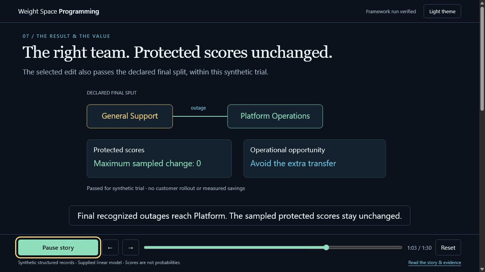

# An outage. The right team.

A 90-second explanation of Weight Space Programming through enterprise support
routing. An outage reaches General Support. The policy wants Platform Operations.
Can a weight edit fix that route while leaving other support behavior alone?

[Watch the recording](../../artifacts/enterprise/support-routing/demo/walkthrough.mp4)
· [Video player](../../artifacts/enterprise/support-routing/demo/index.html)
· [Timed transcript](../../artifacts/explanations/enterprise-story/story.md)
· [English subtitles](../../artifacts/enterprise/support-routing/demo/subtitles.srt)



## Follow the story

| Time | Question | What the picture explains |
| --- | --- | --- |
| 0:00 | What is the use case? | A telemetry outage should reach its owning team directly |
| 0:10 | Why does the wrong team win? | General Support scores 2; Platform scores 0.25 |
| 0:20 | What does a weight do? | Feature times weight gives a score contribution |
| 0:30 | Why not make the quickest edit? | Target-only fitting also changes protected scores |
| 0:40 | What is the framework's core idea? | Choose an edit direction with zero effect on protected inputs |
| 0:51 | What actually changes? | One outage-to-Platform weight goes from 0.25 to about 3.22 |
| 1:01 | What is the result and value? | Final recognized outages reach Platform; a transfer could be avoided |
| 1:11 | When should the framework stop? | Conflicting protection causes abstention; missing coverage causes rejection |
| 1:21 | Can the edit be reversed? | The bound inverse restores the exact parent model |

The figures are original SVG, authored using **STE-Pro-Max storytelling and Line
Studio guidance** at commit `a7da74e83e5fcf8ea23dce075e64b463e5e24584`. A concrete
ticket precedes the formula; a moving signal explains feature contribution; a
two-dimensional slice gives intuition for protection. No Mermaid is used.
The optional upstream STE engine validators were not run. The local generator,
framework checks, browser interaction checks, and media checks provide the stated
validation.

## Run the interactive explanation

From the repository root, with Python 3.11 or newer:

```bash
python -m venv .venv
# Activate .venv using the command for your shell.
python -m pip install -e .
python demos/enterprise-routing/serve.py
```

Open `http://127.0.0.1:8876`. Press **Play story**. Before animation starts, the
server recomputes policy-change, conflict and coverage-gap, then applies the
successful candidate's inverse. **Framework run verified** confirms the expected
admission, zero sampled protected drift and exact parent restoration. Playback
explains these completed results; animation itself does not issue a new model
edit at each scene. Expand **What drove these pictures?** to download the actual
receipts from this browser session.

Pause, scrub the time slider, use the chapter arrows, or reset. The page starts
paused, supports light and dark themes, and replaces interpolated motion with
discrete changes when reduced motion is preferred. The transcript and
understanding check provide a static reading path. Stop the loopback server with
Ctrl+C. No provider, credentials, customer records or frontend build is needed.

The original technical inspector remains at `http://127.0.0.1:8876/technical`.
It exposes candidate comparison, admission, the selected artifact, final
evaluation and rollback receipts for deeper review. A portable copy of the
[story page](../../artifacts/explanations/enterprise-story/index.html), served by
a static HTTP server, uses the verified recorded data instead of calling Python.

## Evidence and limits

The [source and claim register](../../artifacts/explanations/enterprise-story/source.json)
binds observations to published scenario bundles and identifies the schematic
geometry and possible operational benefit as interpretations. The source
generator verifies the admitted edit, final routing, sampled protection and
inverse identity before generating portable data and continuous VTT/SRT cues:

```bash
python demos/enterprise-routing/build_story_source.py
```

These are **synthetic structured records and a hand-constructed fixed-feature
linear head**. They are not a trained text classifier, LLM or customer deployment.
The edit changes `head.weight [3,6]` from `0.25` to `3.22029702970297`. Final
recognized targets route to Platform; maximum sampled protected score drift is
zero. The exact retention certificate covers supplied fixed-feature anchors and
their span under real-valued linear semantics. It does not prove floating-point
execution, text understanding or new feature coverage. The geometry omits other
feature and bias constraints, and the numerical target fit is approximate.

A direct route could avoid a transfer. Handling time, savings and customer
outcomes have not been measured. Rollback restores the model artifact; it does
not reverse external ticket assignments. Read the
[enterprise use case](../../docs/use-cases/enterprise-support-routing.md) for the
contract, evaluator, receipts and research gaps.

## The screen recording

The MP4 captures the entire authored browser explanation at normal speed for
90 seconds. Chrome DevTools Protocol `Page.screencastFrame` supplied real JPEG
frames and presentation timestamps. The idle lead-in and trailing hold were
trimmed; there are no scene cuts, speed-up or substituted frames. Browser chrome
and the workstation desktop are outside the capture. Unchanged frames are held
between events and encoded as H.264 at 24 fps, at 1280 by 720 pixels.

English subtitles are visible in the captured interface for the full story.
[VTT](../../artifacts/enterprise/support-routing/demo/subtitles.vtt) and
[SRT](../../artifacts/enterprise/support-routing/demo/subtitles.srt) files and an
embedded English subtitle track are also provided. There is no spoken narrator.
The quiet cinematic bed uses a credited excerpt of Scott Buckley's “Aphelion,”
with a two-second fade-in and six-second fade-out.
[Music credit and license](../../artifacts/enterprise/support-routing/demo/MUSIC.md).

[The recording receipt](../../artifacts/enterprise/support-routing/demo/recording.json)
contains video, poster, source and subtitle hashes, chapter times, capture
observations, trim alignment and music provenance. It is a local provenance
record, not independent runtime attestation. The playback-start estimate uses
the visible slider's 0.1-second resolution and a contemporaneous browser clock.
Raw frames and local review files remain outside publication.

Given your own actual capture receipt with increasing frame times and a
90-second duration, encode and finish it with FFmpeg and FFprobe on PATH:

```bash
python demos/enterprise-routing/encode_recording.py .runs/story-capture-03/capture.json \
  --source-set story --out .runs/story-encoded
python demos/enterprise-routing/finish_story_recording.py .runs/story-encoded/walkthrough.mp4 \
  --source-receipt .runs/story-encoded/recording.json \
  --capture-receipt .runs/story-capture-03/capture.json --music .runs/aphelion-original.mp3
```

The scripts encode captured footage; they do not automate the browser. The
finish script checks input identities, adds the licensed music and subtitle
track, embeds chapters and validates duration, dimensions and frame count.
Encoded bytes can differ across FFmpeg versions. The older
`edit_recording.py` and `edit-plan.json` describe the superseded recording and
remain for its historical reproducibility; they are not used for this story.
