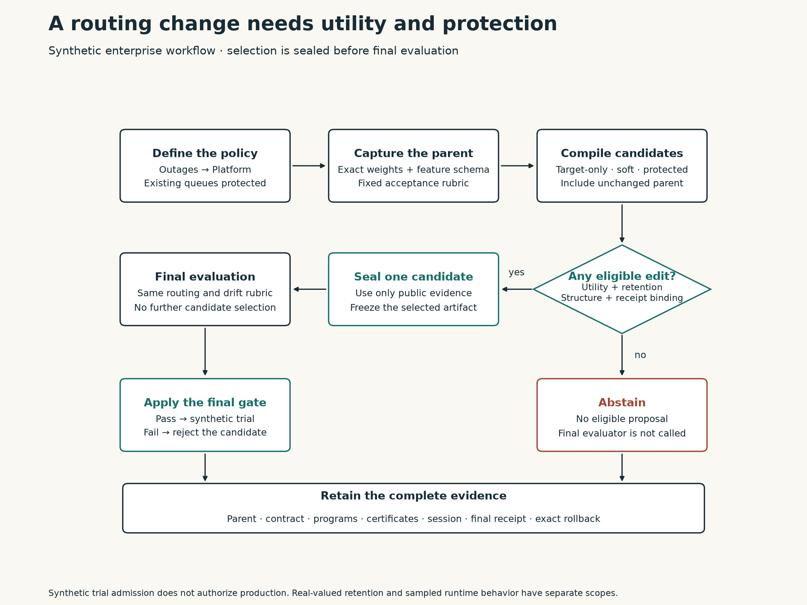
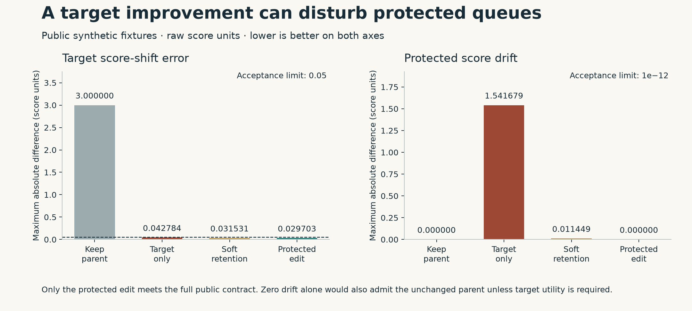

# Enterprise use case: change a routing policy without disturbing existing queues

A support organization launches a telemetry product. Recognized outage tickets
currently reach General Support, which has to transfer them to Platform
Operations. The new policy should send those tickets directly to Platform while
preserving billing, security, ordinary support, and existing platform routing.

This implementation uses the framework to propose a model edit, check both
obligations, select a candidate, and retain evidence for a release decision.
It includes successful admission, an impossible request, and a feature-coverage
failure that only appears in the final evaluation.

**The executable scenario uses invented records, a supplied structured-field
extractor, and a hand-constructed linear routing head.** It establishes an
integration pattern. It does not establish useful editing of a trained enterprise
model, text understanding, provider ability, or production readiness.



[Editable workflow SVG](../../artifacts/enterprise/support-routing/routing-workflow.svg)
· [Runnable implementation](../../examples/enterprise_support_routing.py)
· [Recorded business reports](../../artifacts/enterprise/support-routing/README.md)

## Run and inspect the decision

From the repository root, using Python 3.11 or newer:

```bash
python -m venv .venv
# Activate .venv using the command for your shell.
python -m pip install -e .
python examples/enterprise_support_routing.py
```

The command runs all three scenarios. It writes each report and evidence bundle
under `.runs/enterprise-support-routing/<scenario>/`. It recomputes the saved
evidence before returning a decision.

| Scenario | Selected candidate | Decision | Reason |
| --- | --- | --- | --- |
| `policy-change` | Protected edit | `admitted_for_synthetic_trial` | Requested queues change and protected scores remain fixed |
| `conflict` | None | `abstained` | Protection includes the target direction, leaving no feasible useful update |
| `coverage-gap` | Protected edit | `rejected_after_holdout` | Unseen symptom values do not activate the supplied incident feature |

To run or verify one case:

```bash
python examples/enterprise_support_routing.py --scenario policy-change
python examples/enterprise_support_routing.py --verify .runs/enterprise-support-routing/policy-change
```

The published snapshots can be inspected without rerunning the compiler:

```bash
python examples/enterprise_support_routing.py --verify artifacts/enterprise/support-routing/policy-change
python examples/enterprise_support_routing.py --verify artifacts/enterprise/support-routing/conflict
python examples/enterprise_support_routing.py --verify artifacts/enterprise/support-routing/coverage-gap
```

The verifier uses the recorded structured proposals and literal programs; it
does not refit the ridge solutions. Lowering verification includes the recorded
NumPy version. A different source, fixture, schema, or incompatible numerical
environment can fail exact verification; create a new run and retain both records
rather than replacing the old evidence. The visual source records Matplotlib's
version separately.

## What changes for the business

For a recognized telemetry outage, the parent selects General Support. The
protected edit selects Platform Operations. Its final winner margin is
**1.220297 raw score units**, above the declared 0.5 routing threshold.

Billing and security tickets mentioning the same product remain in their
respective queues. Existing platform incidents remain in Platform. Ordinary
support, core-product outages, and telemetry help requests retain their original
scores and routes on the recorded evaluation rows.

A queue change is different from a score change. The target-only candidate
routes the public outage tickets correctly but also moves an urgent enterprise
help ticket into manual review by narrowing its winning margin. Soft retention
keeps the public queue decisions but still changes protected scores. The
contract in this example requires both queue retention and score retention.

The useful business outcomes in a real pilot would be fewer unnecessary transfers
and faster assignment to the appropriate team, subject to regression limits on
existing queues. This example measures routing and score drift. It has no observed
handling time, staffing cost, customer satisfaction, or service-level outcome.

## The model and its supplied information

The feature extractor reads structured fields, not ticket text. Labels and
cohort membership belong to the evaluator and do not enter the forward equation.
The [fixture](../../examples/data/enterprise_support_tickets.json) contains
synthetic case identities and distinct public and final sets.

| Field | Meaning in this example |
| --- | --- |
| `topic` | Supplied category: `general`, `billing`, `security`, or `platform` |
| `product` | `core` or `telemetry` |
| `symptom` | Supplied symptom vocabulary, including `outage`, `latency`, and `intermittent_errors` |
| `tier` | `standard` or `enterprise` |
| `urgency` | Finite value between zero and one |
| `role` | Evaluator cohort: `target` or `protected`; not a model feature |
| `expected_queue` | Supplied evaluator label; not a model feature |
| `ticket_id`, `case_id` | Declared sample and lineage identities for split checks |

The feature vector has the following order:

```text
[general_topic, billing_topic, security_topic, platform_topic,
 enterprise_tier, urgency, telemetry_outage]
```

The first four entries are topic indicators. The tier entry is one for an
enterprise account. The final entry is one exactly when the topic is `general`,
the product is `telemetry`, and the symptom is `outage`. This interaction feature
is explicitly supplied. It prevents a product mention from automatically taking
billing or security tickets out of their queues.

The head computes `scores = features @ head.weight.T + head.bias`, with output
order `[general, billing, security, platform]`. The bias is fixed. Its stored
baseline weights are:

| Queue | General | Billing | Security | Platform | Enterprise | Urgency | Telemetry outage |
| --- | ---: | ---: | ---: | ---: | ---: | ---: | ---: |
| General | 2 | 0 | 0 | 0 | 0.25 | 0.25 | 0 |
| Billing | 0 | 3 | 0 | 0 | 0.25 | 0 | 0 |
| Security | 0 | 0 | 4 | 0 | 0.25 | 0.5 | 0 |
| Platform | 0 | 0 | 0 | 3 | 0.25 | 0.25 | 0.25 |

These are invented routing scores. They are not calibrated probabilities or
confidence estimates. The adapter selects the largest score if its gap above
the second-largest is at least 0.5. Ties and smaller gaps yield `manual_review`.
Unknown categorical values, invalid urgency values, and an incompatible model
schema raise an error for caller-owned handling.

The artifact binds the architecture identity, tensor shapes, feature and output
order, and the extractor source hash. The adapter checks those declarations
before execution. This local correspondence check does not certify a separate
production extractor or executable backend.

## The edit contract

The rubric is fixed before candidate selection. Every candidate is checked
against the same public targets, protection anchors, and decision rule.

| Obligation | Acceptance criterion | Why it is present |
| --- | --- | --- |
| Requested score change | Maximum absolute error against `[0, 0, 0, +3]` is at most 0.05 | Requires useful change and keeps other target outputs fixed within tolerance |
| Target routing | Every supplied target reaches its labeled queue with margin at least 0.5 | A score shift alone may not change the business action |
| Mathematical retention | Verified certificate has exactly zero residual on the supplied protected features | A small numerical fitting residual is not exact preservation |
| Observed runtime retention | Maximum protected score drift is at most `1e-12` | Checks the recorded NumPy float64 execution separately |
| Protected routing | Every protected ticket keeps its parent route and that route matches its label | Score retention can preserve an already wrong parent action |
| Structural admission | Only `head.weight` is writable; edit cells, parameter magnitudes, and per-cell changes obey the declared policy | Limits the realized program's scope |
| Evidence binding | Parent, program, candidate, contract, and certificate identities agree | Prevents attaching an unrelated receipt to a candidate |

The structural policy permits at most seven edited cells, parameter magnitude
at most four, and per-cell change at most three. These are scenario bounds, not
quality measures or universal enterprise requirements. The adapter has a fixed
bias, so a bias edit fails the write policy even if its tensor shape is valid.

Among publicly eligible candidates, the caller selects the program with the
fewest edited cells, breaking a tie by program SHA-256. If none is eligible, the
session abstains. The caller then seals the selection and runs the same behavioral
rubric on the declared final split. There is no candidate reselection after
observing those outputs. A failed final gate retains the rejected candidate and
its evidence.

## Why the protected update works

Write the feature vector as `(z, q)`, where `q` is the supplied telemetry-outage
indicator and `z` contains the other six coordinates. Every public protected
ticket has `q = 0`. Their feature rows span all six `z` directions: the fixture
contains each topic, an enterprise-tier difference, and an urgency difference.

For a fixed bias, exact retention requires `A @ delta_W.T = 0`, where `A` is
the protected feature matrix. Consequently the only remaining editable direction
is the `q` coordinate. This inference depends on the declared linear head and
the actual rank of the supplied anchors. It is not inferred from ticket names.

Every public target has `q = 1`. The protected compiler therefore fits one
Platform coefficient `d` using mean squared target error and ridge `0.01`:

```text
minimize (d - 3)^2 + 0.01 d^2
d = 3 / 1.01 = 2.970297...
```

The Platform outage coefficient changes from `0.25` to the stored binary64
value `3.22029702970297`. Every other stored coefficient remains unchanged in
this recorded candidate. The remaining target-shift error is approximately
`0.029703`; the positive regularizer deliberately leaves some error.

The generic compiler chooses a numerical nullspace and lowers its structured
addition into a literal program. The exact retention receipt then checks the
**realized endpoint**, interpreting its stored binary64 coefficients and anchor
features as exact dyadic rationals. It is not a proof that the numerical optimizer
found an exact symbolic solution. No new candidate-specific Lean proof is claimed.

For any valid feature row with `q = 0`, the real score change from this candidate
is zero. This includes billing or security tickets mentioning telemetry and
combinations of tier and urgency absent from the public anchors, provided the
extractor and linear-head premises hold. For `q = 1`, the change is confined to
the Platform score. A symptom that fails to activate `q` receives no such change.

## Compare utility and collateral change



[Editable plot SVG](../../artifacts/enterprise/support-routing/score-tradeoff.svg)
· [Bound source fields](../../artifacts/enterprise/support-routing/visual-source.json)

| Candidate | Target shift error, maximum | Protected score drift, maximum | Public conclusion |
| --- | ---: | ---: | --- |
| Keep parent | 3.000000 | 0 | Preserves existing behavior but does not implement the policy |
| Target-only ridge | 0.042784 | 1.541679 | Implements target routes but causes a protected manual-review regression |
| Soft retention | 0.031531 | 0.011449 | Keeps supplied queue decisions but violates exact score preservation |
| Nullspace protection | 0.029703 | 0 | Meets the public contract and passes the final synthetic case |

Both numerical columns use raw score units. They are maximum absolute
differences over their stated cohorts. The target-only and soft controls use
the same public targets, ridge value, parent, and anchors; only the retention
mode changes. This is a constructed comparison, without confidence intervals
or a claim about expected enterprise performance.

## Failure paths are part of the use case

In **`conflict`**, the protection set also contains a target feature row. The
protected directions now span the entire editable feature space. Exact
preservation forces a zero update, so the nullspace compiler produces a no-op.
The unchanged candidate passes retention and fails target utility. All candidates
are rejected on public criteria; the session seals an abstention and does not
call the final evaluator. The recorded certificate remains valid for that no-op.

In **`coverage-gap`**, the public records and selected update are the same as
the successful case. The final target records use `intermittent_errors` instead
of `outage`. Their expected business queue remains Platform, but the supplied
extractor sets `q = 0`. The selected head cannot distinguish them from ordinary
General Support in the desired way. Final target error is three and the routes
remain General. The final gate rejects the sealed candidate.

Changing the extractor to recognize additional symptoms is a new model/interface
change. It invalidates the old correspondence and requires new task identities,
protection assumptions, and an untouched evaluation. Increasing a head coefficient
does not repair a missing feature. Real systems also need evidence about topic
classification and product detection; those fields are supplied correctly here.

## What the evidence contains

Each scenario has a readable `report.md` and a `bundle.json` with:

- The contract, supplied inputs, protected feature matrix, task, and exact parent.
- Every candidate artifact and literal program, including the unchanged parent.
- Structured compiler proposals, lowering receipts, diagnostics, and exact
  endpoint retention certificates.
- Public behavioral metrics, structural checks, eligibility, and rejection reasons.
- The complete cooperative session receipt, declared split validation, candidate
  selection, interface usage, sealed final evaluation, and trace head.
- A final admission envelope binding the task, inputs, contract, selected
  artifact, public admission, final evaluation, and trace.
- The exact inverse program and restored parent identity when an edit is selected.

The selected cases also export `candidate.json`, `edit.json`, and `rollback.json`.
The rejected coverage case exports them for inspection; their existence does
not authorize promotion. `checksums.json` detects file changes. The repository's
publication manifest binds the published snapshot bytes.

Verification reconstructs each candidate from the exact parent and program,
checks lowering and retention receipts, recomputes the public and final rubrics,
checks candidate lineage and the sealed selection, verifies trace links and
accounting, and executes rollback. It checks the exported files and generated
report against the bundle. It does not authenticate an independently owned
evaluator or prevent an author from constructing a completely new bundle.

The session charges observations crossing its interfaces, including the full
parent disclosure for each program proposal. Compiler fitting outside the session
is explicitly allowed and uncharged. Final evaluation is outside proposer
charges. No provider ran, and no total-compute or editor-efficiency comparison
is claimed. Public and final synthetic case identities are disjoint; the fixtures
share supplied construction rules and are already published.

## Carry the pattern into an actual enterprise model

A trained frozen-feature classifier is a natural next integration. Capture its
actual head and feature extractor, declare queue order and numerical execution,
and choose target/protection rows from approved business data. The compiler can
operate on a different feature dimension and output count through the generic
`ReadoutHead` API. The domain rubric and release boundary remain caller-owned.

| Responsibility | Concrete deliverable before a real rollout |
| --- | --- |
| Support policy owner | Approved target policy, protected cohorts, correct baseline labels, and meaningful utility/regression thresholds |
| Model owner | Trained checkpoint, immutable extractor identity, native head equation, captured tensors, and verified import/export correspondence |
| Evaluation owner | Untouched cases separated by relevant customer/incident lineage, frozen selection protocol, and independent final execution |
| Runtime owner | Specified native dtype and backend; measured numerical drift and errors, with a proof argument if one is claimed |
| Operations owner | Shadow routing comparison, rollout decision, drift monitoring, manual-review handling, and coordinated model rollback |

For a model already producing usable embeddings, protect representative queues
and margins rather than assuming that labels alone define the retained span.
More anchors can remove all feasible edit directions. A soft contract might
allow small score drift while preserving routes, but it must set that tolerance
before selection and retain its own result. The exact contract used here is a
deliberate demonstration choice.

A direct business rule is also an appropriate comparator for this particular
structured scenario: the policy is already known and expressible as a condition
on supplied fields. This demo does not establish that a weight edit is preferable
to that rule or to retraining. An enterprise pilot should compare the rule,
unchanged model, protected head edit, and a properly tuned training alternative
at common routing quality, regression, maintenance, and total-cost criteria.

Start a real pilot in shadow mode, where proposed assignments can be compared
with the existing router and reviewed without changing live queues. Evaluate
target transfers, protected misroutes, abstentions, and policy overrides against
the frozen contract. Admit a production rollout only through the organization's
operational decision. Rollback restores weights; already assigned tickets and
other external actions require separate handling.

## How this builds on the paper and research plan

The [source review](../weight-space/v2/source-review.md) distinguishes supplied
semantic hints, identification, intervention, and useful behavior in the original
weight-space work. This example supplies a policy and extractor, permits numerical
fitting, and evaluates queue outcomes separately from coefficient changes. It
does not replicate the source's restricted Go experiment or measure an LLM.

The [limitations and next steps](../weight-space/v2/limitations-and-next-steps.md)
identify gaps that this use case makes concrete:

| Research gap | What this example implements | What remains to establish |
| --- | --- | --- |
| Candidate-specific admission | One domain envelope binds contract, candidate, certificates, public checks, and final gate | A reusable generic admission contract and formal instance binding |
| Numerical correspondence | Separate exact dyadic receipts and measured NumPy float64 output drift | Production dtype, kernels, accumulation, overflow, and extractor correspondence |
| Access and selection | Cooperative session methods, retained controls, predeclared rule, sealed evaluation, abstention | Process isolation, external-data restrictions, provider metering, and independently attested evaluation |
| Feature coverage and feasibility | Full-span conflict and unseen-symptom rejection | Coverage in approved real incident populations and untouched confirmatory units |
| Cumulative edit contracts | Exact-parent rollback for one selected change | Original-baseline retention and operational coordination across multiple policy revisions |
| Scale and usefulness | Runnable domain adapter and inspectable business decisions | Trained large-model benefit, matched alternatives, total cost, and observed service outcomes |

The immediate next experiment is an independently evaluated frozen-head pilot
on approved support data with a protocol fixed before outcomes are observed.
That pilot can establish useful empirical behavior while stating which formal,
numerical, and isolation guarantees are still absent.
