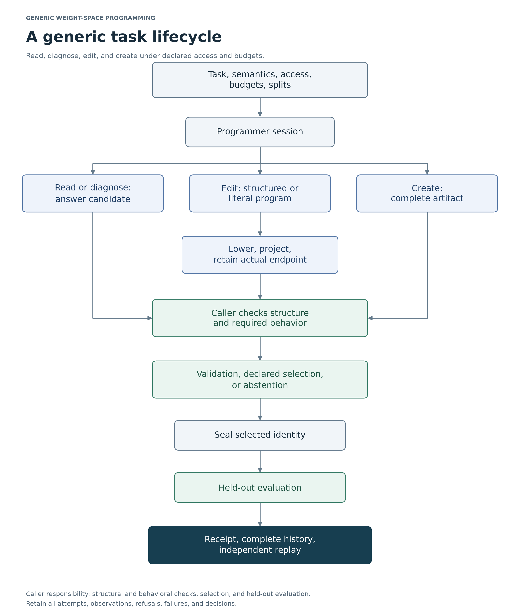

# Weight-space programming: from an edit to a supported claim

Weight-space programming treats model parameters as something a programmer can
inspect and change directly. A proposal may be an answer about a checkpoint, a
diagnosis, an edit to existing weights, or a newly constructed model. The useful
question is what the proposal achieves under a stated information and computation
regime.

This framework gives those proposals a common record. It identifies the parent,
records the proposed and realized change, applies supported checks, retains
candidate history, and separates selection from held-out evaluation. A task may
concern a classifier, a regression head, a controller, or another declared model.
RTS remains a historical application.

The framework is a research draft. Its current evidence establishes small-model
editing mechanisms and conditional real-valued guarantees. Generic interfaces
make other applications possible to describe; usefulness in those applications
still has to be established.

## Why an apparently successful edit needs more explanation

Take a linear head \(y=w\cdot\phi\), with \(w=(1,1)\). Ask for an output increase
of one at feature \((1,1)\). The update \((0.5,0.5)\) satisfies that request.
It also changes the output at \((1,0)\) by 0.5, because both inputs use the first
weight.

If the output at \((1,0)\) must stay fixed, update \((0,1)\) instead. If the target
itself must stay fixed, the request is infeasible under this model. Protecting
both independent feature directions also leaves only the unchanged model.

This exact illustrative case exposes the questions that the framework records:

- **Target:** what output or behavior should change, and by how much?
- **Retention:** what must remain unchanged, on which inputs, and within what tolerance?
- **Realization:** which coefficients did the stored candidate actually acquire?
- **Justification:** which mathematical assumptions or empirical observations
  support the claimed effect?
- **Evaluation:** was the candidate chosen before the final test, and were failed
  attempts retained?

The [worked example](worked-example.md) follows the arithmetic through runnable
code. The [interactive illustration](../../../artifacts/explanations/edit-retention/index.html)
shows the geometry of the available edit directions. Neither is study evidence.

## What changed after reviewing the original work

The starting source is *Sparks of Weight-Space Programming: LLMs can natively
read & write neural network weights*, reported on November 2, 2026, together
with its released experiment artifacts. The [source review](source-review.md)
examines the actual prompts, qualifications, omitted-artifact notices, metrics,
and future directions. It also uses this repository's earlier limitations and
next-step discussions. Its bounded inspection did not establish the existence
of a separate upstream limitations or next-steps file.

The review motivates design choices, not a blanket acceptance or rejection of
the source claims.

| Source problem | Why it matters | Framework response |
| --- | --- | --- |
| A label can be correct while the explanation or repair is wrong. | Identification, mechanism, and causal repair need different evidence. | Separate task modes and caller-defined rubrics; preserve predictions and intervention outcomes. |
| Prompts supply semantics, hints, feedback, and tools. | Success may depend on supplied context as well as weights. | Record access conditions and supplied information; expose metadata, weights, execution, and feedback separately. |
| A parser, factorization, or dtype cast changes the proposed edit. | The intended update may differ from the stored candidate. | Retain structured proposals, exact-parent literal programs, and requested versus realized endpoints. |
| A final patch omits the search that produced it. | Selection, retries, and abandoned attempts affect the claim. | Retain candidates and failures, declare selection, then seal before final evaluation. |
| More rollout samples are not more independent editor trials. | Uncertainty can be too narrow if related observations are counted independently. | Define the independent unit and use paired, world-cluster analysis in the synthetic study. |
| The source proposes auditing, unlearning, recursive improvement, and transfer. | Each needs a distinct success criterion and comparator. | Convert the proposals into separate research questions in the [roadmap](limitations-and-next-steps.md). |

The original Go experiment prohibited regression and least squares. The current
study permits numerical fitting as an explicit algorithmic control. It therefore
does not replicate that restricted experiment, and it does not measure a live
LLM's ability. This difference is essential to interpreting the results.

## Follow a proposal through the framework

[SVG image](../../images/task-lifecycle.svg)

An edit starts with an immutable artifact of named tensors. A literal program
binds changed coordinates to that exact parent and to their stored before-values.
Applying it validates the complete edit before creating a new artifact. A
structured proposal can express blocks or factors; lowering expands it and
records any declared native projection.

The caller then checks the realized candidate. A structural policy can restrict
writable tensors and change magnitudes. A supported certificate can bound real
output drift or compute exact residuals on supplied feature rows. The caller
must decide whether those premises and bounds meet the task's contract.

A session retains the submitted candidates and permitted observations. The
selection rule may choose an edit, keep the parent, or abstain. Sealing fixes that
choice before the caller invokes the held-out evaluator. Submission itself does
not run a contract or prove useful behavior. The [architecture](architecture.md)
and [workflow](workflow.md) explain the implemented steps and their failure modes.

## What each kind of evidence establishes

| Evidence | Supported conclusion | Additional work for a stronger claim |
| --- | --- | --- |
| Artifact and program identities, with replay | Hashes identify the stored values and program; replay can establish that applying the program to the declared parent produces the candidate. | Establish forward semantics and task meaning. Content identity and replay do not attest historical execution. |
| Structural admission | The edit obeys the declared write set and parameter limits. | Measure or bound its effect on outputs. |
| Feature residual receipt | The actual endpoint has the recorded real-valued effect on supplied feature rows. | Establish extractor correspondence and coverage of the intended domain. |
| Sequential drift bound | Supported layer changes obey a real-valued output bound on the declared input box. | Connect that model to numerical execution and downstream decisions. |
| Evaluation receipt | A record associates a caller-supplied result with the selected candidate. | Establish scorer identity, data independence, meaningful metrics, and complete trial reporting. The receipt is not independent attestation of historical execution. |
| Held-out comparison | The measured methods behaved as reported for the declared population and design. | Use untouched tasks or lineages for broader confirmation. |

These records can coexist without a successful repair. A valid program may have
a verified nonzero residual. A no-op can preserve everything while missing the
target. A valid drift bound may be too loose to certify the requested tolerance.
The report should keep those outcomes visible.

## What the proofs explain

For a fixed feature map \(\phi\) and linear head, the actual real-valued change is

\[
h_Q(x)-h_W(x)=(Q-W)\phi(x).
\]

If the bias is editable, include a constant coordinate in \(\phi(x)\) and the
bias column in \(W\) and \(Q\). The protected span must then use those augmented
feature vectors.

If this change vanishes on protected anchors, it vanishes on their feature span.
With nonzero anchor residuals, a new input's bound depends on its representation
coefficients. An off-span component adds another term. This explains both the
possibility of selective edits and the impossibility of changing an exactly
protected target.

A separate result propagates drift through finite sequential networks of varying
width. The implemented certificate covers identity, ReLU, and absolute-value
activations. Tanh execution is available, but this certificate backend does not
cover it. Bounds may be conservative because absolute-value propagation loses
cancellation and correlation.

The [formal guide](formal.md) gives the assumptions, equations, Lean identifiers,
examples, and counterexamples to overbroad interpretations. The [proof reproduction
guide](../../../PROOFS.md) explains the pinned toolchain and trust boundary. The
proofs concern real arithmetic. They do not verify Python, the numerical solver,
an arbitrary feature extractor, hardware floating execution, or an automatic
binding of new study artifacts to Lean definitions.

## What the study found

The study compares editing methods on the same trained output heads across
independent synthetic worlds. The feature families are ReLU MLP, tanh MLP, and
convolution-plus-tanh. Only the heads are trained; these are not independently
trained end-to-end representations or unrelated real-world tasks.

Soft retention reduced collateral NRMSE relative to target-only ridge editing
by `0.689030`. The exploratory 95% world-cluster bootstrap interval was
`[0.674819, 0.703416]`. It increased target NRMSE by `0.321522`, with interval
`[0.299410, 0.344362]`. Both are dimensionless error differences; lower error is
better. The result supports a tradeoff under this design.

The other observations constrain its interpretation:

- When the protected design had full numerical column rank, the nullspace method
  produced no-op proposals. Its retention did not imply target success.
- Smaller protected designs left small, nonzero realized residuals. Numerical
  nullspace selection did not establish exact protection.
- Lower-precision execution differed from lifted binary64 reference evaluation.
  Some requested bfloat16 changes disappeared on projection.
- Composition and rollback recovered parameter identities. Repeated edits still
  showed behavioral interference.
- Sign-reading and analytic-creation fixtures exercised workflow routes. They
  did not test autonomous diagnosis or synthesis. Rounded signed zero remained
  visible; abstention was a prescribed policy.
- The fixed gradient control was not compute matched. The comparison does not
  show that compilation dominates optimization.

Read the [methods](methods.md) for population, objectives, selection, and uncertainty.
Read the [results](results.md) for the full comparisons and contrary findings.
The authoritative numerical rendering is
[study-v2-report-complete](../../../artifacts/weight-space/study-v2-report-complete/report.md).
The older `report-v2` directory is a chart revision of the first study.

## What should happen next

The next engineering task is to join the existing checks into generic behavioral
admission. It must bind the candidate, semantics, domain, required witnesses, and
tolerances in one decision record. A checked proof instance for each candidate
and a specified numerical execution model close different gaps; neither follows
from an admission schema alone.

A live-programmer study then needs a controlled provider harness and fresh tasks.
It should compare identical supplied context with and without weights, retain
editor attempts, and separate reading, diagnosis, intervention, and creation.
Mechanistic claims require frozen intervention predictions and appropriate
controls. Published seeds are available for reproduction, not new confirmation.

Feature coverage, feasible edit directions, cumulative retention, broader
operators, and total cost remain separate research problems. The
[limitations and next-steps plan](limitations-and-next-steps.md) states the failure
each work package addresses, its dependencies, the needed experiment or
implementation, and the outcome that would support or falsify it.

## Choose the next document

| Your next task | Document |
| --- | --- |
| Understand a complete small example | [Worked example](worked-example.md) |
| Inspect the source claims and missing evidence | [Source review](source-review.md) |
| Implement an adapter or compile an edit | [Architecture](architecture.md) |
| Design a programmer session and selection rule | [Workflow](workflow.md) |
| Check a guarantee's assumptions | [Formal explanation](formal.md) |
| Assess the experiment and its conclusion | [Methods](methods.md) and [results](results.md) |
| Review acceptance obligations by source | [Requirements](requirements.md) |
| Plan a contribution or stronger experiment | [Limitations and next steps](limitations-and-next-steps.md) |
| Reproduce evidence without changing the historical record | [Reproduction guide](../../../REPRODUCING.md) and [evidence map](../../../EVIDENCE.md) |

The earlier regression evidence, receipt repair, negative RTS result, and source
limitations remain preserved. This documentation revision changes how the
framework is explained. It does not create new scientific observations or
retroactively strengthen the earlier evidence.
