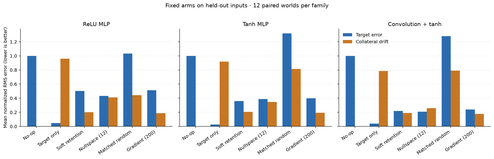
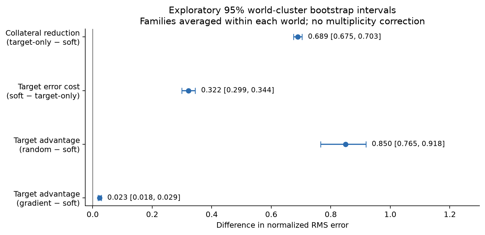
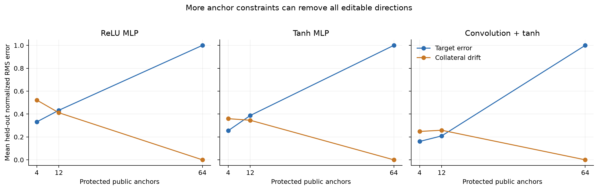
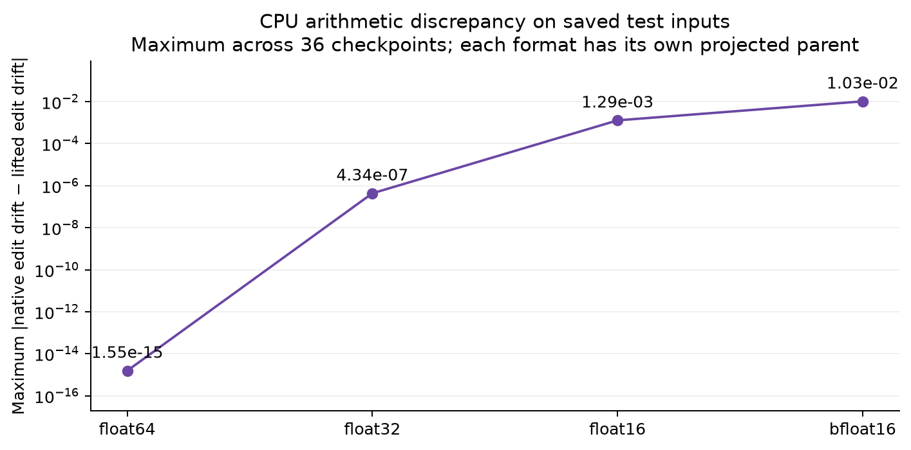
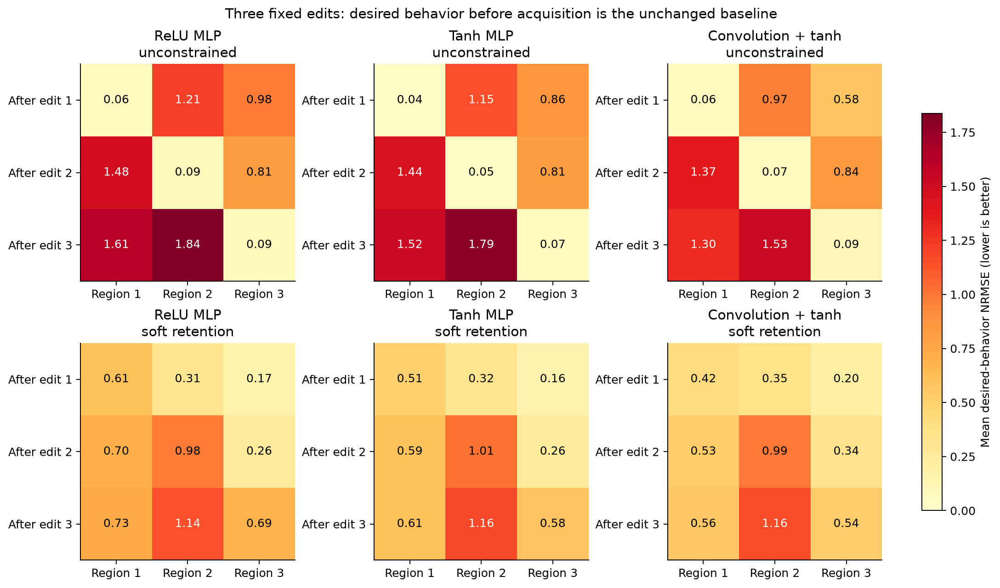

# Generic study results and interpretation

**Soft retention reduced collateral change, at a cost to the requested edit.** Across 12 synthetic worlds, its mean held-out retention NRMSE was **0.199321**, compared with **0.888351** for target-only fitting. Its target NRMSE was **0.360218**, compared with **0.038695**. Errors are measured in units of the requested shift's RMS; lower is better. The paired collateral reduction was **0.689030**, with exploratory 95% world-bootstrap interval **[0.674819, 0.703416]**.

The experiment supports that tradeoff for trained linear heads over random frozen features. It also exposes limits: anchor protection did not ensure exact or unseen preservation, later edits damaged earlier targets, and exact parameter rollback did not imply successful behavior. These are deterministic, fitting-permitted controls. No live LLM or provider arm was run, and the study does not independently replicate the original report.

The [methods](methods.md) define the generator and comparisons. The [source review](source-review.md), [formal guide](formal.md), and [limitations and next steps](limitations-and-next-steps.md) distinguish this evidence from the broader research claims.

## Completion, identities, and independent units

The [saved study](../../../artifacts/weight-space/study-v2/results.json) completed every planned world and checkpoint: **12 worlds and 36 paired checkpoints**, with no failures or omitted worlds. Execution sources were unchanged during the run. The [command record](../../../artifacts/weight-space/study-v2-execution/run-command.json) records exit code zero and elapsed time **162.4463912 seconds**. That is the recorded wrapper duration, not a compute-matched comparison between editing methods. The run is dated November 7, 2026 in UTC and November 6 in America/Chicago.

| Record | Identity or interpretation |
| --- | --- |
| World seeds | 7300–7311; all now observed. |
| Freeze receipt | Canonical identity `0aef8bc624bc5ea501558a807c3c90afa46b3b8ab5d27ea1423943cbb986349e`. |
| Protocol | Semantic identity `c809fc30b69d9fec2fd720c2e80e0d35a08d49a1dd7f6e2f352a6b78e2cbb3de`. |
| Independent uncertainty unit | A world, with its teacher, input streams, and initialization streams. |

Each world contains a ReLU MLP, a tanh MLP, and a convolution-plus-tanh fixture. The three models share that world's teacher and split inputs. They are paired architecture variants, not independent task populations. Each has 16 input coordinates and three output scores. Only output heads were trained; the hidden representations remained random and frozen. Total model sizes were 483, 919, and 195 parameters, respectively.

The declared main and sequence splits contain 960 input rows per world; auxiliary tasks have separate inputs. Reuse across arms, architectures, precision formats, or stages does not increase the number of independent worlds. The source freeze is local integrity evidence, not external preregistration. Later documentation changes are separate from the historical source snapshots.

## What the errors measure

The requested change adds \(s=(0.6,-0.3,0)\) to the original checkpoint's output when \(x_0>0.35\). Retention asks for unchanged output when \(x_0<-0.1\). The gap between those regions is unmeasured by the main task.

For target and retention inputs respectively,

\[
E_T=\frac{\operatorname{RMS}(f_{\mathrm{edit}}(x)-f_{\mathrm{base}}(x)-s)}{\sqrt{0.15}},
\qquad
E_R=\frac{\operatorname{RMS}(f_{\mathrm{edit}}(x)-f_{\mathrm{base}}(x))}{\sqrt{0.15}}.
\]

RMS averages over examples and all three output coordinates. The denominator is the requested shift's RMS. A no-op has target error **1** and retention error **0**. Applying the perfect shift everywhere would give **0** and **1**. Thus a low value on one axis can coexist with failure on the other.

These are dimensionless score errors, not classification accuracy, reward, or probabilities. Directional gain measures projection onto the requested shift and is not generally one minus target error. Raw teacher-relative RMSE below answers a separate question: whether the edited outputs match the synthetic task reference.

## Six fixed arms

Each arm has 36 held-out checkpoint outcomes, with 128 target and 128 retention examples per checkpoint. The means below weight the three families equally because every world completed every family. The [complete summary](../../../artifacts/weight-space/study-v2-report-complete/summary.json) retains unrounded values.

| Arm | Target NRMSE | Retention NRMSE | Directional gain | Parameter-change L2 |
| --- | ---: | ---: | ---: | ---: |
| No-op | 1.000000 | 0.000000 | 0.000000 | 0.000000 |
| Unconstrained target fit | 0.038695 | 0.888351 | 0.989872 | 0.569264 |
| Soft retention | 0.360218 | 0.199321 | 0.700712 | 0.978042 |
| Numerical nullspace, 12 anchors | 0.343031 | 0.338563 | 0.834693 | 1.334016 |
| Matched random | 1.210108 | 0.682883 | 0.001962 | 0.978042 |
| Gradient, 200 steps | 0.383597 | 0.185988 | 0.663043 | 0.655744 |

Target-only fitting nearly reaches the requested shift, but produces substantial change in the retention region. Soft retention penalizes that change during fitting and reaches a different compromise. Its larger parameter L2 also shows why edit size alone is a poor proxy for retained behavior.

The 12-anchor arm has lower mean target error than soft retention but higher unseen retention error. It protects a small set of supplied feature rows, whereas soft retention penalizes all public retention rows. These are different protection objectives.

The random control matches the soft update's requested support and L2; its realized mean L2 also matches at displayed precision. Its target error exceeds the no-op's. This comparison supports the importance of update direction in these fixtures, although one random direction per checkpoint does not describe the full random-edit distribution or prove a causal mechanism.

The gradient control takes 200 fixed steps on the soft objective. It has **worse target error but better retention** than the direct fit. The study does not establish that the direct compiler dominates optimization. It does not tune competing optimizers, equalize compute, or compare full-network fine-tuning.



Each cell below is **target / retention NRMSE**, averaged over 12 checkpoints in that family. The no-op is 1 / 0 for each family.

| Family | Target-only | Soft retention | Nullspace, 12 | Matched random | Gradient |
| --- | --- | --- | --- | --- | --- |
| ReLU MLP | 0.049059 / 0.960867 | 0.501459 / 0.200386 | 0.432874 / 0.411429 | 1.033477 / 0.443767 | 0.512377 / 0.187046 |
| Tanh MLP | 0.027892 / 0.918076 | 0.358731 / 0.205812 | 0.387209 / 0.345725 | 1.317485 / 0.813380 | 0.398428 / 0.192992 |
| Convolution + tanh | 0.039135 / 0.786109 | 0.220463 / 0.191765 | 0.209009 / 0.258535 | 1.279361 / 0.791500 | 0.239986 / 0.177925 |

The retention tradeoff appears in every family. The convolution fixture has 55 augmented editable coordinates, compared with 25 for either MLP. Its lower target errors therefore cannot establish architecture superiority under matched capacity or training, despite its smaller total parameter count.

## Four predeclared paired contrasts

The analysis first averages the three family differences within each world, then bootstraps the 12 world values with 10,000 resamples. Intervals use the fixed analysis seed and percentile endpoints. They are exploratory, without multiplicity correction.

| Contrast | Mean difference, NRMSE units | Exploratory 95% interval |
| --- | ---: | --- |
| Target-only minus soft retention error: collateral reduction | 0.689030 | [0.674819, 0.703416] |
| Soft minus target-only target error: target cost of retention | 0.321522 | [0.299410, 0.344362] |
| Random minus soft target error: advantage over this random control | 0.849890 | [0.765373, 0.917724] |
| Gradient minus soft target error: difference from the fixed iterative control | 0.023379 | [0.017805, 0.029224] |



All four intervals exclude zero in their stated directions for this generator. The first two belong together: retention improved while target accuracy worsened. The last interval concerns target error alone; the gradient arm's retention error is lower. None of these intervals estimates performance across arbitrary neural architectures or LLM editors.

## Validation selection and structural admission

All six arms for all 36 checkpoints passed the structural policy. That policy restricts tensor names and parameter changes; it does not certify target behavior or retention.

Selection required validation target NRMSE ≤1 and retention NRMSE ≤0.35, plus structural acceptance. The fixed rule then minimized target error, delta L2, and lexical arm name in that order. The no-op remained eligible.

| Family | Soft retention selected | Nullspace selected | Gradient selected |
| --- | ---: | ---: | ---: |
| ReLU MLP | 9 | 1 | 2 |
| Tanh MLP | 7 | 5 | 0 |
| Convolution + tanh | 3 | 9 | 0 |
| Total | 19 | 15 | 2 |

The selected candidates had held-out mean target NRMSE **0.345246** and retention NRMSE **0.229042**. All 36 also met the validation thresholds on the test arrays. Target errors ranged from **0.124955 to 0.644140**; retention errors ranged from **0.137529 to 0.337184**.

That test-threshold count is a post-result descriptive check, not another predeclared success endpoint or a certified distributional contract. Selection used validation only and was sealed before test evaluation. Each selected result aliases an already evaluated arm rather than adding an independent candidate.

## Anchor feasibility and exact endpoint residuals

The anchor ablation shows two different limits: protection can remove all update directions, and approximate protection at supplied rows can leave drift elsewhere. Each condition below contains 12 checkpoints. Bias augmentation gives 25 coordinates for either MLP and 55 for convolution.

| Family | Anchors | Numerical rank | Nullity | No-ops | Exactly zero on anchors | Largest exact-residual magnitude | Target / retention NRMSE |
| --- | ---: | ---: | ---: | ---: | ---: | ---: | --- |
| ReLU MLP | 4 | 4 | 21 | 0 | 0 | 2.355e-16 | 0.331434 / 0.522103 |
| ReLU MLP | 12 | 12 | 13 | 0 | 0 | 3.594e-16 | 0.432874 / 0.411429 |
| ReLU MLP | 64 | 25 | 0 | 12 | 12 | 0 | 1.000000 / 0.000000 |
| Tanh MLP | 4 | 4 | 21 | 0 | 0 | 3.889e-16 | 0.254601 / 0.359670 |
| Tanh MLP | 12 | 12 | 13 | 0 | 0 | 6.321e-16 | 0.387209 / 0.345725 |
| Tanh MLP | 64 | 25 | 0 | 12 | 12 | 0 | 1.000000 / 0.000000 |
| Convolution + tanh | 4 | 4 | 51 | 0 | 0 | 4.695e-16 | 0.160404 / 0.247932 |
| Convolution + tanh | 12 | 12 | 43 | 0 | 0 | 5.920e-16 | 0.209009 / 0.258535 |
| Convolution + tanh | 64 | 55 | 0 | 12 | 12 | 0 | 1.000000 / 0.000000 |

Numerical ranks and nullities were the same across each condition's checkpoints. The displayed residuals round values computed by exact rational arithmetic from the stored endpoints and supplied feature rows. **Every non-no-op candidate in this ablation had a nonzero exact anchor residual**: 72 out of 72. Magnitudes near \(10^{-16}\) are small, but they do not meet an exact-zero preservation premise.



At 64 anchors, every numerical kernel was empty. All 36 proposals became no-ops, with exact preservation and no target progress. This is the observed feasibility limit of the numerical procedure. It is not a symbolic rank theorem. The formal infeasibility result requires exact protection and span membership; this study provides no domain-wide feature-span witnesses.

More anchors also failed to improve unseen retention monotonically. Convolution's mean retention NRMSE rose from **0.247932** at four anchors to **0.258535** at twelve. Anchor count alone does not measure coverage. A stronger experiment would vary span coverage and conditioning directly.

## Native precision and realized changes

Each precision format starts from its **own projected parent**. The compiler extracts lifted binary64 features from that parent, fits the soft edit, and projects the candidate. CPU PyTorch then executes the native parent and candidate on saved test inputs. This design measures endpoint and execution differences for each format, rather than changing only the output dtype of one identical model.

| Format | Checkpoints | Native target NRMSE | Native retention NRMSE | Maximum native-versus-lifted edit-drift discrepancy | Rounded endpoint cells | Requested / effective changed cells |
| --- | ---: | ---: | ---: | ---: | ---: | --- |
| Float64 | 36 | 0.360218 | 0.199321 | 1.554e-15 | 0 | 2520 / 2520 |
| Float32 | 36 | 0.360218 | 0.199321 | 4.337e-07 | 2520 | 2520 / 2520 |
| Float16 | 36 | 0.360231 | 0.199307 | 1.287e-03 | 2520 | 2520 / 2520 |
| Bfloat16 | 36 | 0.360280 | 0.199336 | 1.034e-02 | 2520 | 2520 / 2512 |

Cell counts sum across checkpoints. A rounded endpoint cell differs from its requested binary64 endpoint; it can still differ from the parent and count as an effective change. The counts exclude initial parent projection. **Eight requested bfloat16 changes disappeared.** Maximum discrepancy is in raw output units over the observed test outputs and checkpoints, not a worst-case input bound.



Mean errors changed little in these fixtures, while the largest measured execution discrepancy grew at lower precision. Both facts matter: stable aggregate behavior did not make proposal and execution identical. The observations do not cover GPU kernels, decision boundaries, other operation orders, or unseen inputs. No IEEE-execution theorem is supplied, including for float64.

## Three-edit sequences and interference

Every checkpoint received two complete three-edit chains, target-only and soft retention, before sequence test access. The regions were \(x_0<-0.5\), \(|x_0|<0.2\), and \(x_0>0.5\), with different requested shifts. Each new target remained the original model plus its prescribed shift. Soft retention protected the current model in the other regions; it did not enforce a cumulative contract against the original.

| Family | Method | Chains | Final mean target NRMSE | Final prior-region interference NRMSE |
| --- | --- | ---: | ---: | ---: |
| ReLU MLP | Target-only | 12 | 1.178485 | 1.715786 |
| ReLU MLP | Soft retention | 12 | 0.853399 | 0.304080 |
| Tanh MLP | Target-only | 12 | 1.124716 | 1.642258 |
| Tanh MLP | Soft retention | 12 | 0.784631 | 0.285124 |
| Convolution + tanh | Target-only | 12 | 0.976328 | 1.400464 |
| Convolution + tanh | Soft retention | 12 | 0.753396 | 0.333682 |

Target error measures distance from the prescribed final behavior, averaged over all three regions. Interference compares final outputs with each earlier region's outputs immediately after its own edit, averaged over the first two regions. Both use each region's prescribed-shift RMS. Interference measures erosion of what was reached; it does not measure whether the earlier edit ever reached its target.



Before a region is targeted, its desired behavior is the unchanged baseline. The heatmap keeps that region's prescribed-shift RMS as denominator throughout. Target-only fitting reaches the newest shift accurately but disrupts earlier regions. Soft retention reduces this interference, yet its second region's final mean target error is **above one in every family, approximately 1.14–1.16**. On that region it is worse than the unchanged-model reference for the requested shift. Lower interference therefore does not establish successful acquisition and retention of every request.

All 72 chains composed to the same final parameter identity as sequential application, and every rollback restored the original artifact identity. Those exact results coexist with behavioral errors. Literal rollback restores parameters; it cannot reverse deployed actions or external state. Three edits in one order do not establish long-horizon usefulness or absence of forgetting.

## Reading, diagnosis, and creation controls

Each world also contains four sign decisions and two analytic creation cases. Hidden response evaluation uses 128 examples per case. These are controls for separate workflow routes, not additional evidence of large-model understanding.

| Read/diagnose access | Cases | Correct sign | Incorrect sign | Abstentions | Exact response arrays | Maximum response error |
| --- | ---: | ---: | ---: | ---: | ---: | ---: |
| Exact | 24 | 24 | 0 | 0 | 24 | 0 |
| Rounded to three decimals | 24 | 0 | 0 | 24 | 0 | 7.998e-04 |

The coefficient magnitude is 0.0004. Three-decimal access displays `0.0` or `-0.0`, preserving the sign bit. The task tells the fixed reader to abstain at displayed zero, and it does so without using that bit. These observations establish correct execution of the prescribed policy. They do not show that the sign is unrecoverable, that a programmer learned to detect infeasibility, or that a general mechanism was discovered. Abstentions remain separate from correct and incorrect guesses.

Creation compares a zero artifact, one seeded-random artifact, and a preselected analytic construction for each supplied formula. The evaluation tolerance is \(10^{-12}\).

| Formula | Arm | Cases | Within tolerance | Exact response arrays | Mean RMSE |
| --- | --- | ---: | ---: | ---: | ---: |
| Scaled absolute value | Zero | 12 | 0 | 0 | 3.373145 |
| Scaled absolute value | Random | 12 | 0 | 0 | 4.306598 |
| Scaled absolute value | Analytic | 12 | 12 | 12 | 0 |
| Clip | Zero | 12 | 0 | 0 | 0.799402 |
| Clip | Random | 12 | 0 | 0 | 3.083414 |
| Clip | Analytic | 12 | 12 | 12 | 0 |

The analytic networks match their supplied formulas exactly on the hidden arrays. Zero and random controls do not. This checks known constructions and the creation lifecycle; it does not measure autonomous synthesis or generalization to unknown formulas. All three arms remain saved, and the analytic choice preceded test access.

## Teacher-relative errors and real-valued domain bounds

The main edit metrics compare the candidate with its parent. The teacher provides a separate task reference. Before editing, mean RMSE against the unshifted teacher was **0.249446** in the target region and **0.247854** in retention. The desired edited teacher adds the prescribed shift only in the target region.

| Arm | RMSE against shifted teacher on target | RMSE against unchanged teacher on retention |
| --- | ---: | ---: |
| No-op | 0.470232 | 0.247854 |
| Target-only | 0.250060 | 0.432415 |
| Soft retention | 0.288673 | 0.264259 |
| Nullspace, 12 anchors | 0.284989 | 0.287193 |
| Matched random | 0.549483 | 0.385287 |
| Gradient | 0.293504 | 0.262675 |

These values are raw output RMSE. They are not normalized edit errors. Preserving the parent can preserve its approximation error. The no-op's 0.470232 target error is against the **shifted** teacher and should not be confused with its 0.249446 error against the original teacher.

For the 12 ReLU soft-retention candidates, the full-box real-valued drift bound ranges from **5.570890 to 8.295392** for output one and **2.785445 to 4.147696** for output two. Output three has bound zero. The bounds include intended target effects and discard cancellation. They are conservative whole-box bounds, not tight retention-region guarantees.

Runtime receipts evaluate the real-valued recurrence with exact rationals. A separate Lean theorem proves that recurrence under its premises. These JSON endpoints are not automatically generated as checked Lean instances. Tanh and convolution lack corresponding all-layer proofs here; their head-residual checks concern supplied lifted features, not extractor or native-execution correctness.

## Access, accounting, and reproducibility

The main sessions record these interface charges across the 36 checkpoints:

| Counter | Recorded total |
| --- | ---: |
| Tool calls | 708 |
| Weight values charged | 134,148 |
| Feedback calls | 216 |
| Feedback examples submitted | 27,648 |
| Execution calls | 72 |
| Execution examples submitted | 4,608 |
| Proposals | 216 |
| Provider input/output tokens | 0 / 0 |

Evaluator-side model/example executions use another denominator: **55,296** for validation, **110,592** for main holdout, **55,296** for feasibility holdout, **221,184** for precision holdout, and **24,192** for sequence holdout. These are repeated executions, not unique observations. They overlap semantically with interface charges and must not be added as disjoint compute. Training, fitting, feature extraction, auxiliary work, and memory require separate accounting. No provider calls occurred.

The cooperative Python interface records disclosed values, candidates, callbacks, and sealing order. It does not isolate a private evaluator from hostile code in the same process or attest the entire execution history. A no-forward or no-fitting scientific claim requires enforceable restrictions beyond a method-call log.

The [completed rendering receipt](../../../artifacts/weight-space/study-v2-report-complete/receipt.json) binds the renderer, dependencies, inputs, and outputs, and verifies that rendering preserved the closed study tree. The [summary](../../../artifacts/weight-space/study-v2-report-complete/summary.json) contains unrounded derived values; the [generated report](../../../artifacts/weight-space/study-v2-report-complete/report.md) supplies reusable tables and figures.

An earlier rendering timed out after writing outputs but before completing its receipt. It remains an incomplete attempt. The authoritative generic report is `study-v2-report-complete/`; `report-v2/` is instead a later rendering of the first study. The [rendering history](../../../artifacts/weight-space/study-v2-rendering-history.json) preserves these identities and the limits of its retrospective record.

## Independent audit and verification

The [standalone auditor](../../../scripts/audit_weight_space_v2.py) successfully replayed the saved evidence with separately implemented equations and no RLCD imports. Its [report](../../../artifacts/weight-space/study-v2-audit.json), [command](../../../artifacts/weight-space/study-v2-audit-execution/command.json), [completion record](../../../artifacts/weight-space/study-v2-audit-execution/completion.json), and [log](../../../artifacts/weight-space/study-v2-audit-execution/audit.stdout.log) retain the result.

The audit checks closed-file identities, frozen inputs, trained endpoints, literal programs, lowerings, structural admission, selections, supplied-feature residuals, native precision observations, sequence composition/rollback, auxiliary outcomes, and world-bootstrap calculations. It reproduces hashes, types, counters, endpoints, and rational payloads exactly. Numerical observations use absolute tolerance \(10^{-12}\) and relative tolerance \(10^{-10}\).

The saved before/after inventories match, and the historical audit found no current frozen-source difference at that time. Later prose changes have their own publication identities. The auditor can report current-checkout differences while replaying the preserved study; a successful saved audit is not a claim that later explanatory files match the original freeze.

The replay shares NumPy and PyTorch with the experiment. It does not regenerate worlds from seeds, retrain heads, reconstruct optimization paths, prove solver optimality or native arithmetic, or establish that a declared process had no hidden access. Its conclusion is consistency of the saved evidence under those boundaries.

| Audit identity | SHA-256 |
| --- | --- |
| Auditor source | `b7ad808a592539dfb2097fdfb4d53589d11c48e9b77a8ea02b9c494411addad6` |
| Audit report file bytes | `07cc2034a6ca1ee7f730a455523269b627287c473810a8df91a8da64cb84e620` |
| Canonical audit payload | `61d353a88c79e51c47d93c5f12ad318177df0c570858ec17ca85575af457614f` |

The auditor's [adversarial tests](../../../tests/test_independent_weight_space_v2_audit.py) and [saved log](../../../artifacts/weight-space/study-v2-audit-execution/focused-tests.log) exercise rejection of altered evidence. The earlier [integration verification](../../../artifacts/weight-space/verification-v2/README.md) records its own passed run and dependency deprecation warnings. The auditor changed afterward and received separate focused checks. The [formal receipt](../../../formal/weight-space/verification-v2/actual/verification.json) records the proof build and axiom audit. These checks address implementation and proof integrity; they are not extra experimental units or evidence of useful editing.

A separate session review recomputed summaries, intervals, and precision counts and inspected the figures, but did not retain a machine-readable receipt. It is not a substitute for the linked audit, rendering, integration, and formal records.

To audit or render the saved study, use unused destinations outside its directory:

```powershell
.venv/Scripts/python.exe scripts/audit_weight_space_v2.py --study-root artifacts/weight-space/study-v2 --freeze artifacts/weight-space/study-v2-freeze/receipt.json --repo . --expected-freeze 0aef8bc624bc5ea501558a807c3c90afa46b3b8ab5d27ea1423943cbb986349e --expected-protocol c809fc30b69d9fec2fd720c2e80e0d35a08d49a1dd7f6e2f352a6b78e2cbb3de --out artifacts/weight-space/my-v2-audit.json
.venv/Scripts/python.exe scripts/report_weight_space_v2.py --study artifacts/weight-space/study-v2 --out artifacts/weight-space/my-v2-report
```

## Conclusions that follow, and experiments still needed

The local conclusion is a retention tradeoff in explicit small-model fixtures. The common workflow also retained distinct candidate, task, and evidence identities across these fixtures. Neither conclusion establishes autonomous LLM editing or useful changes on a broad task population.

| Supported finding | Stronger claim that remains unestablished | Observation that would weaken that stronger claim |
| --- | --- | --- |
| Soft retention lowers mean collateral drift while increasing target error here. | A reliable advantage on new tasks, lineages, or compute-matched optimizers. | The tradeoff disappears or reverses on untouched units, or a matched control reaches a better operating point. |
| Supplied anchors constrain numerical updates. | Exact preservation or distribution-wide retention. | Nonzero realized residuals or drift outside the protected span. Both already occur here. |
| Native endpoint and execution differences can be measured. | A worst-case numerical guarantee. | A violating input or backend, despite small average errors in these arrays. |
| Parameter composition and rollback are exact. | Cumulative acquisition and retention of desired behavior. | An earlier target fails after a later edit. The sequence already shows this limit. |
| A known analytic construction reproduces a supplied formula. | Autonomous synthesis or learned mechanistic understanding. | Failure on unknown formulas or failure to outperform controls with the same contextual information. |

The [next-step program](limitations-and-next-steps.md) specifies feature coverage, integrated behavioral contracts, runtime proof binding, enforceable access experiments, causal interventions, longer sequences, and scale measurements. Those are proposals for new evidence.

Every published study seed is observed. Fresh confirmation requires new units and a protocol fixed before their outcomes. The first study's regression estimates remain conditional on its shared dataset. Its historical RTS result remains a **selected no-op with zero held-out effect**, and missing RTS checkpoint bodies remain missing. This generic study changes neither record; see the [first-study results](../results.md) and [project memory](../../PROJECT_MEMORY.md).
